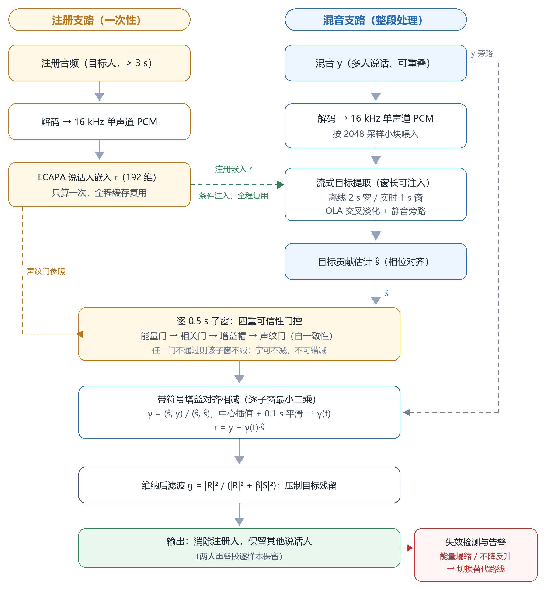
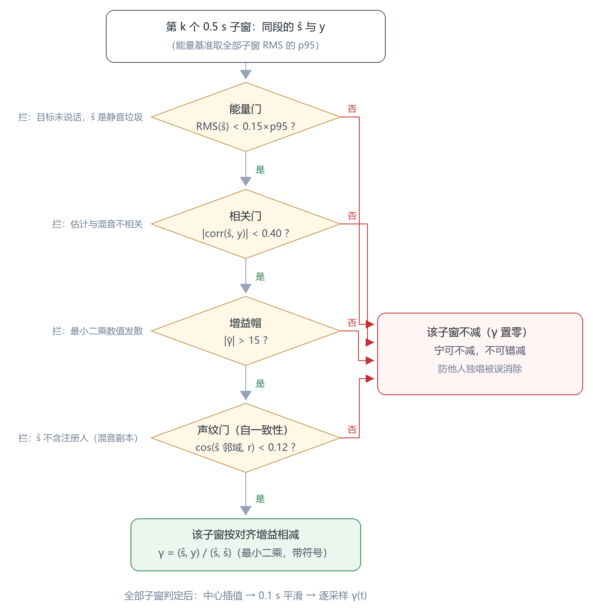

| 项目 | 内容 |
|---|---|
| 发明名称（建议） | 一种基于目标说话人提取模型的注册说话人反向抑制方法、装置、电子设备及存储介质 |
| 技术领域 | 语音信号处理；目标说话人提取（TSE）；说话人抑制 |
| 申请人 / 发明人 | （待填写） |
| 撰写日期 | 2026 年 11 月 |
| 附图 | 图 1 反向抑制总体流程（§6.1）；图 2 子窗四重门控判定（§6.5） |

# 1 简要说明本发明的目的以及基本方案

## 1.1 拟解决的需求

单麦克风录到的往往是多人声音与环境声的线性叠加。设混音信号为 y(n)、目标说话人（下称“注册人”，指提供过注册语音的那个人）的真实语音为 s_t(n)、其他说话人为 s_o(n)、噪声为 v(n)：

$$y(n) = s_t(n) + s_o(n) + v(n) \qquad (1)$$

已有技术回答的是“怎么只留下注册人”（目标说话人提取）；本发明回答的是**相反**的问题——已知混音 y 和注册人的一段注册语音，如何从混音中**消除注册人、保留其他所有说话人**（包括两人同时说话的重叠段），供后续转写、播放、存档或脱敏使用。典型应用：

- 会议 / 客服质检中剔除数字人播报或特定坐席的声音，只转写客户与人声；
- 录音证据整理、素材脱敏：隐去指定人的声音但保留对话其余各方；
- 直播 / 访谈后期：去掉某个已授权（或已禁言）的说话人；
- 通话、面审等轮流发言场景中压制指定一方。

## 1.2 发明目的

在“仅单麦克风、仅一段数秒注册语音”的弱条件下，达到三个具体目标：

1. **重叠段可分**：两人同时说话时，注册人被消除而对方语音逐采样保留（不是整段取舍）；
2. **不误伤**：注册人没在说话的段落（他人独唱、静音），输出不劣化——宁可不减，不可错减；
3. **失效可知**：模型在特定信道（如 8 kHz 窄带电话音）上整体退化时，系统能自行检测并告警、切换替代路线，而不是输出一个看似成功实则错误的结果。

## 1.3 基本方案（一段话版）

以注册语音计算说话人嵌入作为条件，驱动一个**预训练的目标说话人提取（TSE）网络**逐窗输出注册人在混音中那份贡献的**相位对齐**估计 ŝ；由于该类网络以尺度不变损失（SI-SDR）训练，其输出相对真实贡献可带**任意整体极性与增益**（且极性可在同一文件内翻转），因此不能直接相减——本发明逐子窗做**最小二乘带符号增益估计**，并级联**四重可信性门控**（能量门、相关门、增益帽、声纹自一致性门），只有判定“该子窗的估计确实可信地对应注册人”才按对齐增益相减，得到逐采样增益曲线 γ(t) 与残差 r = y − γ(t)·ŝ；残差再做**维纳式后滤波**压制目标残留；全流程配有**失效检测**（输出能量塌缩 / 不降反升）与**替代路线切换**。同一提取引擎支持**窗长可注入**的双工作点：实时链路用短窗（1 秒）保低延迟，离线处理用长窗（2 秒及以上）换单窗提取质量。

# 2 相关术语解释

| 术语 | 解释 |
|---|---|
| 目标说话人提取（TSE） | 已知混音与目标人注册语音，用神经网络直接估计目标人在混音中的语音波形的任务；“是谁”作为条件进入网络输入。 |
| 反向 TSE / 说话人抑制 | 本发明任务：消除注册人、保留其他所有人。与 TSE 输出互补：残差 ≈ 混音 − 目标贡献。 |
| 注册（enrollment） | 目标人提供一段语音（本方案下限 3 秒）供计算声纹参照的过程。 |
| 说话人嵌入 | 描述“这声音是谁”的定长向量；同人方向相近、异人方向分开。本方案用到两种：ECAPA-TDNN（192 维，作 TSE 的条件）、ER2Net（512 维，中文数据训练，作声纹门与门控路线的判定）。 |
| ECAPA-TDNN / ER2Net | 两类“帧级编码 + 注意力统计池化 + 投影”结构的说话人嵌入网络，前者为分离网络内置条件编码器，后者为独立声纹模型。 |
| BSRNN | 频带分割循环网络：把复数频谱不均匀切成若干子带，带内沿时间、带间沿频带交替做注意力的分离骨干；有因果（在线）变体。 |
| 复数比值掩码（CRM） | 分离网络输出的复数“保留比例”，乘回原始混合谱：幅度按模缩放、相位按辐角旋转。 |
| SI-SDR（尺度不变信噪比） | TSE 的常用训练损失；先估计到真实信号方向的最小二乘投影再取能量比，对输出的整体幅度与极性**不敏感**——这是本发明必须做增益对齐的根源。 |
| 带符号增益对齐 | 逐子窗估计 Ŝ 相对混音中标定目标的实数增益（含正负号），把 ŝ 校正到与混音同极性、同幅度后再相减。 |
| 子窗 | 增益估计与门控判定的基本单位，本方案取 0.5 秒。 |
| 四重门控 | 能量门、相关门、增益帽、声纹门四道级联的可信性判定；任何一道不通过，该子窗增益置零（不减）。 |
| 声纹门（自一致性校验） | 对**估计信号 ŝ 本身**取说话人嵌入、与注册嵌入比余弦，校验“要减掉的确实是注册人”，专防模型退化时输出混音副本。 |
| 维纳后滤波 | 在时频域按 g = \|R\|² / (\|R\|² + β\|S\|²) 对残差再收一刀的比值增益，压制目标残留。 |
| OLA / COLA | 重叠相加 / 恒定重叠相加：逐窗独立推理的结果用互补的梯形合成窗拼接，重叠区两窗权之和恒为 1，拼接无增益跳变。 |
| 静音旁路 | 窗内语音占比低于阈值的窗口跳过网络前向、原声乘合成窗直接放行的省算力机制。 |
| 积压丢弃 | 输入缓冲超过“一个窗口 + 容忍量”时丢最旧保最新，使流式延迟有界的机制。 |
| 迟滞双阈值 | 进入阈值与退出阈值分离的判定状态机：进入需高于上门限、退出需跌破更低的下门限，防同类判定在中途掉分时反复抖动。 |
| 窄带音频 | 有效带宽约 300–3400 Hz 的电话类音质音频；与宽带训练的模型失配时会引起整体退化。 |
| 实时因子（RTF） | 处理耗时 / 音频时长，小于 1 才跟得上实时。 |
| 对齐相减（配准相减） | 用归一化互相关在混音中定位一段已知波形并逐采样减去的经典手段，仅当混音中确实存在与注册**逐采样一致**的回放时有效。 |

# 3 详细介绍技术背景

## 3.1 需求背景：“反向的鸡尾酒会问题”

“鸡尾酒会问题”指人能在多人混合声中选择性注意某一人，自动系统很难做到。围绕它，产业界绝大多数投入在**正向**——把目标人取出来（提取、增强）。但对称的需求同样真实且长期没有好解：**把指定的人从混音中去掉、留下其余所有人**。这个需求在内容生产（去数字人播报、去某位嘉宾）、合规脱敏（隐去受保护人的声音）、通信质检（只听客户、不听坐席）里反复出现，且多数场景只有单麦克风、只有目标人的一段参考语音。

## 3.2 已有技术路线与本任务的关系

| 技术路线 | 代表 | 与“消除指定人”的差距 |
|---|---|---|
| 语音增强 / 降噪 | 谱减、维纳滤波、深度降噪 | 目标是噪声，不是“指定的某个人”；人声对人声无差别。 |
| 盲源分离 | Conv-TasNet、DPRNN 系 | 输出路数需先验；存在排列不定问题，分出来还不知道哪路是谁，需再接说话人辨认，两阶段误差叠加。 |
| 目标说话人提取 / 语音过滤 | VoiceFilter、SpeakerBeam、SpEx/SpEx+、WeSep(BSRNN) | 输出的恰恰是注册人本人（要去掉的那个）；“其余人”作为互补输出并不在其设计目标内。 |
| 个人 VAD | Personal VAD | 只输出“目标人在说话”的帧级概率，不产生波形；重叠帧无法区分，之后仍无法消除。 |
| 阵列空域零限 | LCMV / GSC 阻塞矩阵 | 需要多麦克风与方位信息，单麦克风场景不可用。 |

## 3.3 本发明赖以构建的技术基础：条件化 TSE

近年 TSE 的成熟形态是：注册语音经说话人编码器（如 ECAPA-TDNN）得到嵌入向量 r；分离网络（如 BSRNN）以 r 为条件，在复数频谱上估计复数比值掩码，重构目标人波形；以 SI-SDR 损失训练；配合因果骨干与重叠相加可以做流式。开源生态（WeSep 工具链等）提供了高质量预训练权重，使“不重训模型直接复用”成为有价值的工程路线。这些构成了本发明的物质基础——但如 §5 所推导，把它们**直接反过来用**（提取再减）会失败。

## 3.4 一个关键的既有事实：SI-SDR 损失的尺度—极性不变性

TSE 网络普遍以尺度不变信噪比训练（式 3、4，见 §4）。该损失对估计的整体幅度与**极性**完全不敏感：训练收敛后，网络输出 ŝ = γ·s_t（γ 为任意非零实数）与 ŝ = s_t 在损失上等价。这在“只要听清内容”的提取任务里无害，但在“要逐采样相减”的抑制任务里是致命的结构性障碍——这是本发明全部增益对齐与门控设计的出发点。

# 4 最接近的现有技术

最接近的现有技术是**基于说话人嵌入条件化的目标说话人提取系统（VoiceFilter / WeSep 类，BSRNN 骨干）及其“提取—直接相减”变通使用**。前者是公开技术（也是本发明人在先系统所用，内部技术文档《AudioTSE技术论文-声纹门控与TSE》有完整记载）；后者是工程上拿到 TSE 模型后做“消除”的最自然做法。分两部分描述。

## 4.1 条件化提取系统本身

**注册支路**：注册语音（≥3 秒）→ Fbank 特征 + 倒谱均值归一化 → ECAPA-TDNN 编码器 → 192 维嵌入 r，整段处理只计算一次并缓存，逐窗注入分离网络（避免逐窗重算的条件抖动）。

**分离支路**（逐窗前向，窗长 1 秒、步长 0.9 秒）：

$$\hat{s}(n) = f_{\theta}(y,\ r) \qquad (2)$$

f_θ 为预训练分离网络：加窗 STFT 得复数谱 → 按训练配置切成若干子带 → 逐带归一化与线性编码 → 双路径（带内时间 / 带间频带）注意力分离器，说话人嵌入经 sigmoid 门控逐通道注入 → 每带输出复数比值掩码 M，乘回**旁路保留的原始混合谱** → iSTFT 回波形。

**训练目标**为尺度不变信噪比：先求估计在真实信号上的最小二乘投影系数

$$c = \frac{(\hat{s},\ s_t)}{|s_t|^2} \qquad (3)$$

再取投影信号与误差的能量比

$$\mathrm{SI\text{-}SDR} = 10\,\log_{10}\frac{|c\,s_t|^2}{|c\,s_t - \hat{s}|^2} \qquad (4)$$

（(a, b) 表示内积，\|a\| 表示模长。）将 ŝ 整体乘以任意非零常数（含负数），分子分母同倍变化，损失不变——即式 (4) 只约束波形**形状**，不约束整体增益与极性。

**流式化机制**（与提取质量无直接关系，本发明反向模式全部复用）：因果骨干逐窗独立推理；梯形合成窗（窗头线性淡入、窗尾线性淡出、互补保证重叠区权之和恒为 1）做重叠相加；窗内语音占比过低则跳过前向（静音旁路）；输入积压超限丢最旧保最新（延迟有界）。

## 4.2 “提取—直接相减”变通（消除指定人的最自然做法）

$$\tilde{r}(n) = y(n) - \hat{s}(n) \qquad (5)$$

即把提取网络的输出从混音里逐采样减掉，得到“其余声源”。若 ŝ 精确等于 s_t，由式 (1) 线性叠加原理，r̃ = s_o + v，任务完成——这是该方案全部吸引力所在：**不需要任何新模型、任何训练**。本发明人在先系统的实时链路即以此方式实现了反向模式（逐窗输出 = 窗 − 目标估计，仍乘合成窗做重叠相加）。

**实测定位**：在两人全程重叠的中文测试集上，2 秒窗提取质量约 15 dB SI-SDR（1 秒窗约 9 dB；另一公开口径测试样本为 12.6 / 7.3 dB）；直接按式 (5) 相减的结果**比不处理还差约 1.5 dB**。原因见下节。

# 5 以因果关系推导现有技术的缺点

以下按“因为 A（结构 / 训练层面的原因）→ 所以 B（行为层面的必然表现）→ 表现为 C（工程上的失效）”的因果链逐条推导。C 中均有实测。

**链一：极性与幅度失配——直接相减反而把目标加回去。** 因为 TSE 以 SI-SDR 损失训练（式 3、4），该损失对整体增益与极性不变 → 所以网络收敛到哪个极性、哪个幅度是训练随机性的产物，推理输出 ŝ = γ·s_t 中 γ 可为任意非零实数，且同一文件不同段还可翻转 → 表现为：实测提取输出约为**反相、幅度 31%** 的目标副本；按式 (5) 相减实际执行的是 y − γ·s_t，γ 为负时等于把目标**增强**后加入混音——实测比不处理还差 1.5 dB。**结论：尺度不变性使“直接相减”在数学上就不成立，必须先做带符号的增益对齐。**

**链二：目标缺席时的退化输出——减掉副本会误伤他人。** 因为条件提取网络是“给定条件必给输出”的映射，没有目标存在性判断 → 所以注册人不在说话（他人独唱、静音）时，条件被强行满足，模型输出退化为近静音垃圾**或整段混音的 ±副本** → 表现为：减掉混音副本会把他人独唱一起消除（把该保留的清零），产生“消除成功”假象下的严重误伤。**结论：相减前必须逐段校验估计的可信性，不可信就不减。**

**链三：实时短窗的估计残留。** 因为流式实时要求窗口短（1 秒，首字延迟的实测拐点），因果模型没有未来帧，区分“同一时刻谁在说”只能靠窗内时间上下文 → 所以窗口越短估计质量越差 → 表现为 1 秒窗单窗 SI-SDR 仅约 9 dB，相减后目标残留可闻。**结论：离线场景应允许更长窗（质量优先），实时场景保持短窗（延迟优先）——同一引擎需要窗长可注入。**

**链四：信道带宽失配——减法变放大且无告警。** 因为预训练权重来自宽带语料（如 VoxCeleb）→ 遇 8 kHz 窄带电话音质音频时输入统计整体失配 → 所以模型输出退化为**反相缩小的混音副本**（实测输出与输入相关度 −0.97）→ 表现为式 (5) 的减法反而放大混音；且现有方案没有任何失效指示，用户拿到的是一个看似成功的错误结果。尝试把窄带频谱搬移“伪装”成宽带再推理，实测与真值仍负相关，无效。**结论：必须有显式失效检测（能量判据）与替代路线（窄带改走声纹判定）。**

**链五：门控式抑制（另一类现有做法）的重叠盲区。** 因为按窗做声纹判定、对目标人片段整窗衰减的做法，其嵌入是窗内各说话人嵌入的凸组合：q ≈ ρ·r + (1−ρ)·o（ρ 为目标人占比）→ 相似度随 ρ 连续变化，任何单阈值都存在误放 / 误拒两难的过渡带 → 所以两人同时说话的窗口无法区分，只能整窗同衰减或同保留 → 实测重叠段他人语音保真度仅 0.15；且该路线固有约一个判定窗的切换过渡带。**结论：整窗取舍原理上处理不了重叠，重叠段必须走“估计—对齐—相减”的波形级路线。**

**链六：波形配准相减（又一类现有做法）只认固定回放。** 因为互相关配准要求混音中存在与注册波形**逐采样一致**的信号 → 所以只有数字人播报、IVR 提示音这类固定录音回放能被精确定位与消除（此场景下它确实是最优解）→ 表现为对自由说话的注册人（内容与注册音频不同）互相关无峰，完全失效。**结论：自由说话的注册人必须走 TSE 估计路线；固定回放场景可走配准路线，两者是互补关系而非替代关系。**

**小结**：四类现有路线在“消除指定人”任务上的缺点根源各不相同，但都致命：

| 路线 | 因果根源 | 失效表现 |
|---|---|---|
| TSE + 直接相减 | SI-SDR 尺度—极性不变（链一）+ 无存在性判断（链二） | 目标被加回（−1.5 dB）；他人独唱被误清零 |
| 声纹门控整窗衰减 | 嵌入凸组合的相似度过渡带（链五） | 重叠段整窗误伤（保真 0.15） |
| 波形配准相减 | 只匹配逐采样一致的回放（链六） | 自由说话完全失效 |
| 盲分离 + 辨认 | 排列不定 + 路数先验 + 两阶段误差 | 多人场景不可控，工程复杂 |

此外，四者共同缺失的一环是**失效检测**（链四）：错误结果不带任何告警地流向下游。

# 6 本发明技术方案的详细阐述

## 6.1 总体架构

图 1 给出总体流程。整个系统由**注册支路**（一次性）、**混音支路**（整段处理）与**合并处理段**构成，分五个阶段：

- **S1 预处理**：注册音频与混音各自解码为 16 kHz 单声道 PCM；
- **S2 注册嵌入**：注册语音 → ECAPA-TDNN 嵌入 r，计算一次全程缓存；
- **S3 窗长可注入的流式提取**：混音逐窗过条件化 TSE 网络，得注册人贡献的相位对齐估计 ŝ；
- **S4 带符号增益对齐相减**：逐 0.5 秒子窗做四重可信性门控 + 最小二乘带符号增益估计，插值平滑为逐采样增益 γ(t)，残差 r = y − γ(t)·ŝ；
- **S5 维纳后滤波与失效检测**：残差在时频域再收一刀；输出能量异常时告警并切换替代路线。

**流程说明**：图 1 上部两列分别是注册支路（琥珀，一次性）与混音支路（蓝，整段处理）。注册嵌入 r 有两处消费：作为条件注入提取网络（虚线，全程复用），以及作为 S4 声纹门的参照（虚线）。混音 y 除走提取支路外还旁路直达 S4（虚线）——增益估计与相减都要以原始混音为对象。S4 各子窗未通过门控则增益置零（宁可不减，不可错减）；S5 输出其他人语音，异常时进入失效检测（红）。

## 6.2 S1 预处理

任意容器 / 采样率 / 声道的输入统一解码为 16 kHz 单声道 PCM16。混音按小块（2048 采样 = 128 毫秒）喂入提取引擎，与实时采集帧一致——这保证离线脚本与实时链路复用同一套带缓冲保护的流式机器，大块喂入不会触发积压丢弃的误判。

## 6.3 S2 注册嵌入：算一次，缓存注入

注册语音（≥3 秒）经 Fbank + 倒谱均值归一化后过 ECAPA-TDNN 得 192 维嵌入 r。整段处理只计算一次，逐窗注入分离网络（式 2 的条件）：既省去逐窗重复计算，更保证相邻窗条件完全一致，不引入拼接缝的额外抖动。换注册人时只需重算嵌入（亚秒级），无需重载网络权重。

## 6.4 S3 窗长可注入的流式提取

分离引擎的**窗长与交叉淡化长做成可注入参数**，同一权重、同一代码路径支持两个工作点：

| 工作点 | 窗长 | 单窗提取质量（SI-SDR） | 取向 |
|---|---|---|---|
| 实时链路 | 1 秒 | 约 9 dB（另一口径样本 7.3 dB） | 首字延迟优先 |
| 离线反向抑制 | 2 秒 | 约 15 dB（另一口径样本 12.6 dB） | 相减质量优先 |

机理：BSRNN 逐子带做带内统计归一化，窗越长窗内统计越稳，掩码估计越好；代价只是离线场景不敏感的时延。反向抑制默认取 2 秒窗 + 0.25 秒交叉淡化，复用与实时链路完全相同的重叠相加、静音旁路与积压丢弃机制——静音窗（语音占比 < 5%）跳过前向原样放行，这在抑制任务里同样正确：无语音即无可消除。

## 6.5 S4 带符号增益对齐相减（核心步骤）

这是本发明区别于现有技术的关键。逐 0.5 秒子窗（记第 k 个子窗内混音段为 y_k、估计段为 ŝ_k）执行两件事：**先门控、后估计**。

**（1）最小二乘带符号增益**。以混音为对象估计 ŝ 的实数增益：

$$\hat{\gamma}_k = \frac{(\hat{s}_k,\ y_k)}{(\hat{s}_k,\ \hat{s}_k)} \qquad (6)$$

该估计天然带符号：γ̂ 为负即自动纠正反相输出；γ̂ 同时吸收幅度失配。它把式 (5) 的“盲目相减”升级为“**对齐后相减**”，从数学上消解链一。

**（2）四重可信性门控**。相减的前提是“这个子窗的 ŝ 可信地对应注册人”，四道门按代价从低到高级联，任一不通过则该子窗增益置零：

$$G_k = \hat{\gamma}_k \cdot \mathbf{1}[\,\text{四门全部通过}\,] \qquad (7)$$

| 门 | 判据（优选值） | 拦截的失效（对应因果链） | 实测依据 |
|---|---|---|---|
| 能量门 | 子窗 RMS(ŝ_k) < 0.15 × 全部子窗 RMS 的 95 分位 → 不减 | 注册人未说话、输出近静音垃圾（链二） | 退化段能量塌缩两个量级 |
| 相关门 \|corr(ŝ_k, y_k)\| < 0.40 → 不减 | 估计与混音不相关、不可信（链二） | 垃圾段相关近零 |
| 增益帽 | \|γ̂_k\| > 15 → 不减 | 最小二乘除小范数发散（数值保护） | 正常段 \|γ\| 中位 1–10，发散段 30–150 |
| 声纹门 | ŝ_k 中心 ±1 秒邻域的 ER2Net 嵌入与注册嵌入余弦 < 0.12 → 不减 | ŝ 是混音副本而非注册人——**减掉它会清零他人独唱**（链二、链四） | 真目标段余弦 0.2–0.7，退化段约 0.03 |

其中**声纹门是本发明最具区别性的设计**：它不是对混音、而是对**提取输出本身**做声纹自一致性校验——“要减掉的这段声音确实像注册人吗”。这一步把链二、链四中“模型退化成混音副本”的情形在相减前拦下，是“宁可不减，不可错减”原则的技术落点。

**（3）逐采样增益曲线**。各子窗的 (中心时刻, G_k) 判定值线性插值到逐采样，再做约 0.1 秒的滑动平均平滑：

$$\gamma(n) = \mathrm{smooth}\big(\mathrm{interp}\{\,(c_k,\ G_k)\,\}\big)(n) \qquad (8)$$

平滑消除子窗边界的增益台阶，防止相减结果出现可听的周期性“咔嗒”。最终残差：

$$r(n) = y(n) - \gamma(n)\,\hat{s}(n) \qquad (9)$$

未通过门控的子窗 γ(n) = 0，输出退化为原混音——**保底行为是“不处理”，而不是“处理错”**。

**流程说明**：图 2 是单个 0.5 秒子窗的判定流程：能量门 → 相关门 → 增益帽 → 声纹门按代价从低到高级联（声纹嵌入计算最贵，放最后）；左侧灰字标注各门拦截的具体失效；任一门不通过（红分支）该子窗增益置零，四门全过（绿）才按最小二乘增益相减。全部子窗判定完成后统一插值、平滑成 γ(t)。

## 6.6 S5 维纳后滤波

相减残差中仍可能有目标残留（估计不完全 + γ 平均化）。以**对齐后的估计** S = γ·ŝ 为先验，在时频域对比残差与估计的能量：

$$g(f,t) = \frac{|R(f,t)|^2}{|R(f,t)|^2 + \beta\,|S(f,t)|^2},\qquad r'(n) = \mathrm{ISTFT}[\,g \odot R\,] \qquad (10)$$

R = STFT(y) − STFT(S) 为残差谱。估计有能量而残差弱的时频点被判为目标残留、被压低；残差强的点（他人语音）增益接近 1 不受影响。β 为强度参数（优选 1，可关断）。实测目标抑制量从 39 dB 提升到 42 dB。

## 6.7 失效检测与多路线切换

输出端用能量比做两道失效判据（能量判据比相关判据稳健：正确的消除只能减少或保持总能量）：

$$\frac{\mathrm{rms}(r')}{\mathrm{rms}(y)} < \delta_c\ (\approx 0.05)\ \ \text{或}\ \ \frac{\mathrm{rms}(r')}{\mathrm{rms}(y)} > \delta_h\ (\approx 1.05)\ \rightarrow\ \text{判定失效} \qquad (11)$$

前者是输出能量异常塌缩（窄带音频使宽带模型整体退化的典型特征），后者是消除模式能量不降反升（反相副本被放大）。命中即显式告警并提示切换替代路线。系统内建三条互补路线，按目标人特性选择：

| 路线 | 机理 | 适用 | 边界 |
|---|---|---|---|
| A 增益对齐相减（本发明主路线） | TSE 估计 + 四重门控 + 带符号增益相减 + 维纳后滤波 | 宽带音频、自由说话、真重叠 | 窄带音频上模型退化（由式 11 检出后切换） |
| B 声纹反门控 | 3 秒滑窗声纹判定 + 迟滞双阈值（进入 0.40 / 退出 0.20）+ 三点中值 + 判定点间线性插值增益 | 轮流发言、窄带（窄带上同 / 异人余弦 0.6–0.95 对约 0，区分度极好） | 重叠窗无法区分（保真 0.15）；衰减须到底——实测 −30 dB 残留仍被流式识别流畅转写 |
| C 配准相减 | 归一化互相关全局定位注册波形的每次出现（最多 6 次）+ 逐 5 秒块局部重对齐（±0.1 秒）+ 块内最小二乘增益 + 块相关下限跳过 | 固定录音回放（数字人、IVR、彩铃） | 仅认逐采样一致的回放；自由说话无峰 |

路线 C 在其适用场景内近乎无损（实测数字人回放与真人重叠段：重叠区人声相关系数 1.000、保真度 1.00、回放区 RMS 降至 0）；其残留再接路线 B 兜底（覆盖回放库未收录的同声线语音）。

## 6.8 流式实施例（同一引擎的实时反向模式）

实时链路以“逐窗互补输出”实现反向模式：每个窗的输出为本窗混音减本窗估计，再乘梯形合成窗进入重叠相加：

$$r_w(n) = \omega(n)\,[\,x_w(n) - \hat{s}_w(n)\,] \qquad (12)$$

x_w、ŝ_w 分别为第 w 窗的混音与估计，ω 为满足恒定重叠相加条件的合成窗。静音旁路、积压丢弃、尾部冲刷与正向提取完全共用，实时因子同量级。优选地，式 (6)(7) 的子窗增益估计本身是**因果的**（只用到当前子窗采样），把插值改为向前外推、平滑改为短窗因果平滑，即可在本实施例上叠加增益对齐与门控，获得与离线路线一致的极性 / 退化保护，额外延迟不超过一个子窗（0.5 秒）。

## 6.9 实施效果（实测）

测试条件：16 kHz 单声道、两人**全程重叠**的中文测试集（真值已知），注册语音数秒；普通 CPU，无 GPU。

| 指标 | 数值 | 说明 |
|---|---|---|
| 残差 SI-SDR（相对他人语音） | −1.2 dB → **+12.8 dB** | 基线（直接输出混音）对增益对齐相减 |
| 目标抑制量 | **39 dB** | 投影分解测得的注册人分量衰减 |
| 他人语音损伤 | **0.5 dB** | 投影分解测得的对方分量变化 |
| 目标抑制量（+ 维纳后滤波） | 39 → **42 dB** | 式 (10)，β = 1 |
| 直接相减（式 5）对照 | 比不处理**差 1.5 dB** | 反相输出被“减”成了“加” |
| 场景稳健性 | 全程重叠 / 50% 部分重叠 / 目标偏轻 / 目标偏响四场景 | 增益对齐相减在全部场景稳定优于直接减法，γ×1.0 优于 0.92 / 1.0 两档缩放 |

## 6.10 参数优选表

| 参数 | 优选值 | 可调范围说明 |
|---|---|---|
| 提取窗长（离线 / 实时） | 2 s / 1 s | ≥2 s 质量增益趋缓；实时受首字延迟约束 |
| 交叉淡化长 | 0.25 s（离线）/ 0.1 s（实时） | 须小于窗长 |
| 增益估计子窗 | 0.5 s | 过短增益噪声大，过长跟不上极性翻转 |
| 能量门下限 | 0.15 × 全部子窗 RMS 的 p95 | 自适应于整体电平 |
| 相关门下限 | 0.40 | 垃圾段相关近零，界限清晰 |
| 增益帽 | 15 | 正常段 \|γ\| 中位 1–10 |
| 声纹门下限 | 0.12 | 真目标段 0.2–0.7 对退化段约 0.03 的间隙内取 |
| 声纹判定邻域 | 子窗中心 ±1 s | 嵌入所需最短语音 |
| γ 平滑窗 | 0.10 s | 消子窗边界咔嗒 |
| 维纳强度 β | 1.0 | 0 = 关断 |
| 失效塌缩比 δ_c / 放大比 δ_h | 0.05 / 1.05 | 能量判据 |
| 注册语音下限 | 3 s | 保证嵌入稳定 |
| 门控路线滑窗 / 步长 / 迟滞 | 3 s / 1 s / 0.40 与 0.20 | 窄带实测同 / 异人区分度标定 |
| 配准路线块长 / 局部搜索 / 块下限 | 5 s / ±0.1 s / 0.50 | 容忍转码电平漂移与时钟漂移 |

# 7 本发明的关键点和欲保护点

**建议作为独立保护点（方法 + 装置 + 设备 + 存储介质）：**

**K1（总流程）** 一种注册说话人反向抑制方法：以注册语音的说话人嵌入为条件，用目标说话人提取网络得到注册人在混音中贡献的相位对齐估计；对所述估计逐子窗估计**带符号增益**，经可信性门控后按逐采样增益曲线从混音中相减，得到保留其他说话人的残差；残差经比值后滤波输出。

**K2（带符号增益对齐）** 如 K1，所述增益为逐子窗以混音为对象的最小二乘带符号增益（式 6），经判定中心插值与平滑得到逐采样增益（式 8、9）——针对尺度不变损失导致的任意极性 / 幅度失配的配套手段。

**K3（四重门控 + 估计自一致性校验）** 如 K1，相减前逐子窗口级联执行能量门、相关门、增益帽与声纹门，任一不通过则该子窗增益置零；其中声纹门对**提取估计本身**取说话人嵌入并与注册嵌入比对（自一致性校验），拦截模型退化输出的混音副本。

**K4（失效检测与路线切换）** 如 K1，以输出 / 输入能量比的上、下双门限检测整体退化（式 11），命中告警并切换至声纹反门控或配准相减替代路线。

**建议作为从属保护点：**

**K5** 维纳式后滤波以对齐后估计为先验构造比值增益压制残差（式 10）。
**K6** 提取引擎窗长可注入：同一权重实时短窗 / 离线长窗双工作点（§6.4）。
**K7** 流式反向模式：逐窗“混音 − 估计”乘满足恒定重叠相加的合成窗拼接（式 12），与静音旁路、积压丢弃共用；以及子窗增益因果化的低延迟变体（§6.8）。
**K8** 声纹反门控替代路线：滑窗嵌入 + 迟滞双阈值 + 中值滤波 + 判定点间线性插值增益曲线（§6.7 路线 B）。
**K9** 配准相减替代路线：归一化互相关多次定位 + 逐块局部重对齐 + 块内最小二乘增益 + 相关下限跳过，残留接声纹兜底（§6.7 路线 C）。
**K10** §6.10 参数表中各优选取值及自适应形式（能量门以子窗 RMS 分位数为基准等）。

# 8 替代方案（针对第 4 节最接近的现有技术，以及本发明各关键点的可替换手段)

**8.1 专用抑制网络端到端训练**。直接以“注册人 + 混音 → 其余人”训练一个抑制网络（输出残差），原理上可绕开增益对齐问题。代价：需要重新构造训练数据与目标、重新训练，放弃海量预训练 TSE 权重的复用；且仍需单独解决目标缺席退化与失效检测问题。本发明 K1 的“提取 + 对齐相减”是其零训练替代，权利要求建议覆盖上位概念（消除注册人、保留他人的处理链），不限定于相减实现。

**8.2 盲分离 + 说话人辨认**。先分离出各路再辨认、丢弃注册人那一路。可行但受排列不定、输出路数先验、两阶段误差三重制约，计算量为全路分离；作为背景技术已在 §3.2 排除，不建议作为实施例，但应知悉审查员可能引用。

**8.3 频域软减法替代时域相减**。不做时域相减，而在时频域以估计谱构造抑制掩码（如 g = max(0, 1 − \|Ŝ\|/\|Y\|) 或广义维纳形式 (\|Y\|² − \|Ŝ\|²)/\|Y\|²）乘回混合谱。可行，且与 K5 的后滤波同族；相位处理弱于“混合谱 − 对齐估计谱”的复数域相减，实测口径见 K5。建议在 K1 权利中以“从混音中扣除对齐后的目标贡献（时域或时频域）”表述覆盖两者。

**8.4 增益估计器替代**。K2 的逐子窗最小二乘可替换为：全文件单增益 + 极性预判（段间翻转场景失效）、归一化互相关法、RLS / LMS 自适应滤波在线跟踪、子窗中值等稳健估计。逐子窗最小二乘为优选（因果、闭式、带符号、计算可忽略）。

**8.5 门控变体**。K3 的四门可增删换序：用 VAD 判 ŝ 是否含语音替代能量门；用分离网络的置信度输出（若有）替代相关门；声纹门可换嵌入模型（ECAPA / ER2Net / x-vector）或改为对 (ŝ 与 y 之差) 的归属校验。核心特征“对估计本身做声纹自一致性校验后再决定是否相减”应保持。

**8.6 后滤波替代**。K5 的维纳形式可替换为谱减法、OM-LSA 类最优修正对数谱幅度、或将残差二次送入提取网络迭代抑制。维纳形式为优选（闭式、单参数、以对齐估计为先验）。

**8.7 多麦克风扩展**。有多通道时可叠加空域零限（LCMV / 阻塞矩阵）先压一路，本发明的单通道处理作为残余处理级联。

**8.8 骨干与嵌入模型替换**。BSRNN 可换 TFGridNet、DPCCN、Conv-TasNet(SpEx+) 等任何以嵌入为条件的提取骨干；ECAPA 可换任何说话人编码器。本发明各关键点（对齐、门控、失效检测）与骨干无关。

已实测排除的变体（供代理人答辩备查）：窄带频谱搬移“伪装宽带”后推理，输出与真值仍负相关，无效；门控路线保留 −30 dB 残留衰减，流式识别仍能流畅转写——防转写必须衰减到底。

# 9 其他有助于专利代理人理解技术的资料

## 9.1 与工程源码的对应

| 模块 | 位置 | 内容 |
|---|---|---|
| 增益对齐相减主流程（K1–K3、K5） | `app/scripts/suppress-target-v2.py` | 四重门控、子窗最小二乘增益、插值平滑、维纳后滤波、失效告警 |
| 三路线离线实现（K4、K8、K9） | `app/scripts/suppress-target.py` | aligned（配准相减 + 声纹兜底）、gate（迟滞反门控）、wesep（直接减法对照） |
| 提取引擎与流式机器（K6、K7） | `app/backend/audio_tse/tse.py` | 窗长可注入的引擎、extract / suppress 双模式、重叠相加、静音旁路、积压丢弃 |
| 实时反向链路（K7） | `app/backend/audio_tse/server.py` | tse-suppress 处理器：同一引擎的反向任务 |
| 客观评测 | `app/scripts/eval-suppress.py`、`eval-scenarios.py` | SI-SDR、双路投影分解、窗长扫描、多场景稳健性 |
| 正向算法完整推导（背景） | `tech-docs/AudioTSE技术论文-声纹门控与TSE.md` | 门控与 TSE 两种算法的 50 条公式、流式机制、实测口径 |

## 9.2 实测数据原始记录（口径与源码一致）

- 提取输出实测为**反相、幅度 31%** 的目标副本，同一文件不同段极性还会翻转；直接相减比不处理差 1.5 dB；
- 两人全程重叠测试集：SI-SDR −1.2 → +12.8 dB；目标抑制 39 dB（+维纳 42 dB）；他人损伤 0.5 dB；
- 声纹门实测间隙：真目标段余弦 0.2–0.7，退化段约 0.03，门限 0.12 取间隙内；
- 增益实测：正常段 |γ| 中位 1–10，数值发散段 30–150（增益帽 15 拦截）；
- 窗长 1 s → 2 s 单窗提取质量约 9 → 15 dB（本抑制测试集）；公开口径样本 7.3 → 12.6 dB；
- 窄带实测：能量 92.8% 集中在 1 kHz 以下、8 kHz 以上为零；宽带模型输出与输入相关 −0.97（反相副本）；ER2Net 同人 0.6–0.95 / 他人约 0；
- 配准相减实测：数字人回放与真人对话重叠 15 秒样本，重叠区人声相关系数 1.000、保真度 1.00、回放区 RMS 0.00000。

## 9.3 参考文献

1. Wang Q., Muckenheim H., et al. VoiceFilter: Targeted Voice Separation by Speaker-Conditioned Spectrogram Masking. *Interspeech*, 2019.
2. Delcroix M., Zmolikova K., et al. Single-Channel Target Speaker Extraction and Recognition with SpeakerBeam. *ICASSP*, 2018.
3. Ge M., Wang S., et al. SpEx: Multi-Task Time-Domain Speaker Extraction Network. *Interspeech*, 2020.
4. Luo Y., Yu J. Band-Split RNN: The Beat Goes On. *IEEE/ACM TASLP*, 2023.（BSRNN 及因果变体）
5. Williamson D. S., Wang D. L., Wang S. Complex Ratio Masking for Monaural Speech Separation. *IEEE SPL*, 2016.
6. Luo Y., Mesgarani N. Conv-TasNet: Ideal Time-Domain Filters for Single-Channel Speech Separation. *IEEE/ACM TASLP*, 2019.
7. Desplanques C., Thienpondt J., Demuynck K. ECAPA-TDNN. *Interspeech*, 2020.
8. An F., Zhang H., et al. 3D-Speaker-Net: Reinforcing Speaker Embedding via Speaker Interaction and 3D Convolution. 2023.（ER2Net）
9. Ding S., et al. Personal VAD: Speaker-Conditioned Voice Activity Detection. *Interspeech*, 2020.
10. wenet-e2e 团队. WeSep：开源目标说话人提取工具链（本方案分离权重来源）.
11. 本发明人在先技术文档：《AudioTSE技术论文——声纹门控与TSE》（2026 年 10 月，内部资料；正向两算法的完整数学推导与实测）。

## 9.4 与在先技术文档（论文）的关系

论文记载的是**正向**系统（声纹门控按句取舍 + 目标说话人提取重构波形）的完整方案；本交底书的核心发明点（带符号增益对齐相减、四重门控、失效检测与路线切换、反向流式模式）均在其之后提出、未在论文中公开。论文中的以下内容作为本交底书的背景与部件直接引用：条件化提取的六步前向、重叠相加与静音旁路、嵌入凸组合导致的门控重叠盲区（§5 链五的推导依据）。

## 9.5 已知局限（如实告知）

- 当前分离权重为英语语料（VoxCeleb）训练，中文重叠语音上的泛化已在本项目测试集验证，更大规模验证仍在进行；
- 窄带（8 kHz 电话音质）音频上主路线模型整体退化，须按 §6.7 切换路线 B（系统可自动检出并告警）；
- 门控路线的固有切换过渡带约一个判定窗（3 秒内），迟滞与中值滤波已将其压至线性渐变、无可听硬切。
