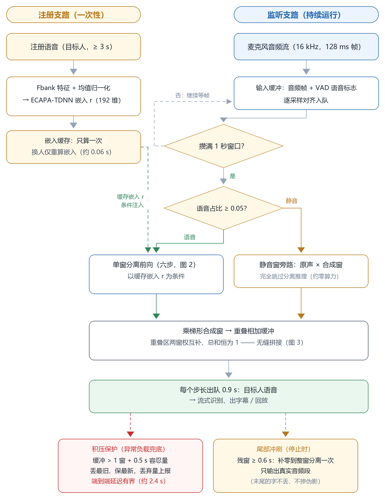
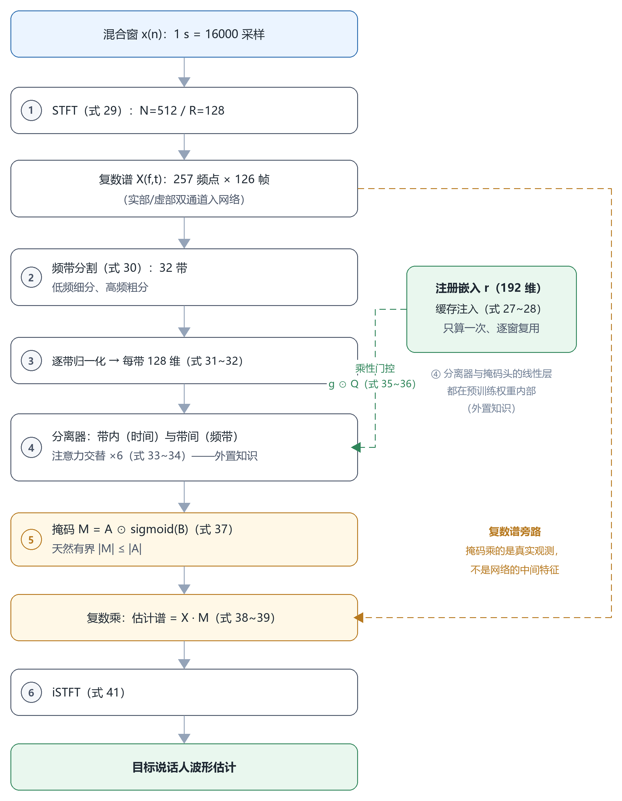
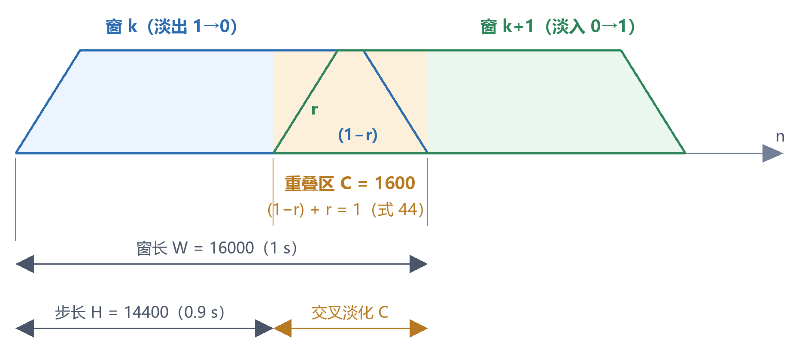
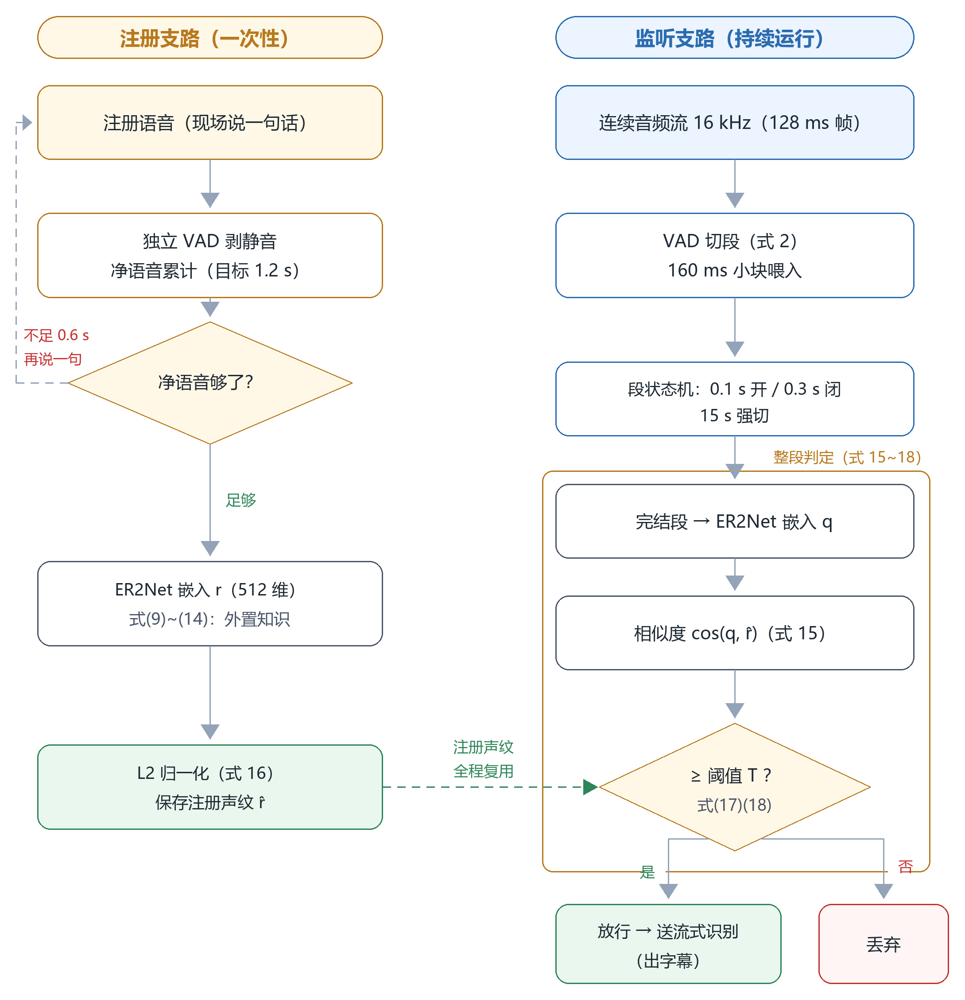

| 项目 | 内容 |
|---|---|
| 发明名称（建议） | 一种单麦克风实时目标说话人提取方法、装置、电子设备及存储介质 |
| 技术领域 | 语音信号处理；目标说话人提取（TSE）；流式语音处理 |
| 申请人 / 发明人 | （待填写） |
| 撰写日期 | 2026 年 11 月 |
| 附图 | 图 1 总体流程与流式主循环（§6.1）；图 2 单窗分离前向六步（§6.3）；图 3 合成窗与重叠相加（§6.4）；图 4 声纹门控流程（§6.11） |

# 1 简要说明本发明的目的以及基本方案

## 1.1 拟解决的需求

单麦克风录到的从来不是一个人的声音，而是多个人的语音与环境噪声直接叠加的混合信号（近似线性相加）。下游任务——实时字幕、会议转写、语音指令、通话、助听器——都只需要其中**指定那一个人**的声音：即目标说话人提取（TSE），已知混音和目标人的一段注册语音，把目标人的语音波形从混音中重构出来。人耳能在多人混合声里自然地“只听某一个人”，自动系统做起来非常难（鸡尾酒会问题）。

## 1.2 发明目的

已有 TSE 网络基本在**整段离线**条件下工作：把一段完整音频喂进网络、一次性输出结果。本发明的目的是让 TSE 在**真实实时约束**下可用：

1. **单麦克风**：不依赖多通道与空间信息；
2. **纯 CPU**：不依赖 GPU，普通终端（笔记本、一体机）即可部署；
3. **实时流式**：音频边录边出结果，延迟有界且实测达标——首字延时约 1.7～2.5 秒，实时因子约 0.8（处理耗时 / 音频时长，小于 1 才跟得上实时）；
4. **现场注册即用**：陌生人走过来当场念一段注册语音即可开始提取；换人无需重新加载模型（约 0.06 秒对约 5 秒）。

## 1.3 基本方案（一段话版）

以注册语音计算说话人嵌入并**缓存一次、逐窗注入**；混音按 **1 秒窗口分块**送入**因果**目标说话人提取网络逐窗独立推理（网络的因果性保证切窗不破坏模型假设）；每窗输出乘**满足恒定重叠相加（COLA）条件的梯形合成窗**后重叠相加——相邻窗重叠 10%，重叠区内两窗权重互补、总和恒为 1，拼接无增益跳变、无缝；窗内语音占比过低的**静音窗跳过网络前向**、原声乘合成窗直接放行；输入积压超限时**丢最旧保最新**，把端到端延迟钳在与运行时长无关的上界（约 2.4 秒）；停止时对尾部残窗**补零冲刷**一次、只取真实音频段；**逐窗不做幅度归一化**（与尺度不变训练目标配套，防止拼接缝出现幅度调制噪声）；提取引擎（约 262 MB 权重）**会话级加载、连接后空闲时段预加载**，换注册人只重算嵌入。以上机制全部免训练、与骨干网络无关。系统还配套一个**声纹门控**协同层：轮流发言场景先用极低算力的“按句声纹取舍”，抢话、打断、重叠场景才切换到上述分离链路——两种算法共用同一注册协议。整体流程见图 1。

# 2 相关术语解释

| 术语 | 解释 |
|---|---|
| 目标说话人提取（TSE） | 已知混音与目标人注册语音，用神经网络直接估计目标人语音波形的任务；“是谁”作为条件进入网络输入，区别于不知道目标的盲分离。 |
| 注册（enrollment） | 目标人提供一段语音供计算声纹参照的过程；本系统 TSE 链路要求 3 秒以上，门控链路约 1.2 秒净语音即可。 |
| 说话人嵌入 | 描述“这声音是谁”的定长向量；同人方向相近、异人分开。本系统用 ECAPA-TDNN（192 维，作分离网络条件）与 ER2Net（512 维，中文数据训练，作门控判定）两种。 |
| 因果（在线）模型 | 时间建模只依赖当前与过去帧、不使用任何未来帧的网络变体；这是切窗独立推理不破坏模型假设的前提。 |
| BSRNN | 频带分割循环网络：把复数频谱不均匀切成子带，带内沿时间、带间沿频带交替做注意力的分离骨干。 |
| 复数比值掩码（CRM） | 网络输出的复数“保留比例”，乘回原始混合谱：幅度按模缩放、相位按辐角旋转，兼修幅度与相位。 |
| SI-SDR（尺度不变信噪比） | TSE 常用训练损失：先把估计投影到真实信号方向再取能量比，对估计的整体幅度不敏感，只约束波形形状。 |
| 分析窗 / 合成窗 | 两种不同的窗，不可混淆：分析窗是频域变换的**帧级**窗（512 点汉宁窗）；合成窗是流式拼接的**窗级**梯形窗（16000 点）。 |
| OLA / COLA | 重叠相加 / 恒定重叠相加：相邻窗输出按互补权叠加；COLA 指任一采样点上各窗权之和恒为常数（本方案为 1），拼接过程单位增益、不产生谱畸变。 |
| 静音旁路 | 窗内语音占比低于阈值的窗口跳过网络前向、原声乘合成窗直接放行的省算力机制；跳过推理但不跳出拼接体系。 |
| 积压丢弃 | 输入缓冲超过“一个窗口 + 容忍量”时丢弃最旧溢出部分、只分离最新窗口，使延迟有界的机制；丢弃量累计上报。 |
| 尾部冲刷 | 停止提取时对不足一窗的尾部补零到整窗分离一次、只输出真实音频占位的部分，保证末尾的字不丢也不掺伪影。 |
| 实时因子（RTF） | 处理耗时 / 音频时长，小于 1 才跟得上实时；本方案 TSE 链路（含识别）约 0.8。 |
| 首字延时 | 从目标人开口到其语音对应结果输出（字幕出现）的端到端时间；本方案固有口径约 1.7 秒、全口径约 1.9～2.5 秒。 |
| VAD（语音活动检测） | 逐帧判断“这帧是不是语音”的轻量检测器（本方案所用模型不到 2 MB）。 |
| 声纹门控 | 不改波形、按“这句话像不像注册人”逐段取舍的低算力算法；与 TSE 按“能门控就门控、要分离才分离”协同。 |
| 短注册补偿 | 注册净语音不足 1.5 秒时把判定阈值按系数 0.7 下调（0.5 → 0.35）的机制。 |
| 滑窗判定 / 指数平滑 | 流式场景下每 500 毫秒取最近 1 秒判一次、用独立阈值 0.25；判定序列经指数加权平均（系数 0.5）抑制抖动。 |
| 会话级引擎 / 预加载 | 分离网络权重与“提取谁”无关，提到连接级只加载一次；连接建立后的空闲时段预热，到点击开始时只剩固有延迟。 |

# 3 详细介绍技术背景

## 3.1 应用背景

多人同时说话的场景里，混音信号会明显拉低下游任务质量：识别错误率上升、字幕串人、指令误触发。“只取目标人”是刚需，且越来越多场景要求**当场、实时**：会议与访谈的实时字幕、客服质检的实时转写、车载与音箱唤醒后的指令、助听器、直播字幕。这些场景的共同点：单麦克风（或只有单通道可用）、终端算力有限、延迟必须稳定有界、目标人无法提前录入（陌生人现场注册）。

## 3.2 技术谱系与本发明的位置

| 技术路线 | 代表 | 与本需求的差距 |
|---|---|---|
| 阵列波束形成 | MVDR、GEMM | 需要多麦克风与方位先验，单麦克风不可用。 |
| 语音增强 / 降噪 | 谱减、深度降噪 | 去噪不去“人”；对人声干扰无效。 |
| 盲源分离 | Conv-TasNet、DPRNN 系 | 不知道哪一路是目标（排列不定），输出路数需先验，还需“先分离、再认人”的第二阶段。 |
| 说话人日志（diarization） | 聚类 / 端到端 diarization | 只标注“谁在什么时候说”，不改写波形，重叠段依旧混在一起。 |
| 目标说话人提取 | VoiceFilter、SpeakerBeam、SpEx/SpEx+、BSRNN 系 | 任务定义对口，但公开工作以**整段离线**处理为主；实时流式化（分块、拼接、算力、延迟、换人）缺少完整方案。 |

## 3.3 条件化提取的技术基础

近年 TSE 的成熟形态：注册语音经说话人编码器（如 ECAPA-TDNN）得到嵌入向量；分离网络（如 BSRNN）以该嵌入为条件，在复数频谱上估计复数比值掩码、重构目标波形；以 SI-SDR 损失训练。开源生态（WeSep 工具链等）提供了含**因果（在线）变体**的高质量预训练权重。因果变体的存在使“切窗独立推理”在模型假设层面成为可能——这是本发明流式化的物质基础；但把可能性变成“纯 CPU 上实测实时、延迟有界、无缝、可现场换人”的完整工程方案，正是现有技术缺失的部分（见 §5）。

## 3.4 一个关键的既有事实：SI-SDR 的尺度不变性

TSE 网络普遍以尺度不变信噪比训练。该损失对估计的**整体幅度不敏感**：输出整体放大任意倍数，损失不变。这在离线整段处理里无害；但在流式逐窗处理里，它意味着**相邻窗的输出增益天然可能不一致**——任何在窗一级“各自为政”的幅度处理（如逐窗归一化）都会把这种不一致放大成可听的拼接噪声。这是本发明若干设计（逐窗不归一化、COLA 合成窗）的共同出发点。

# 4 最接近的现有技术

最接近的现有技术是**基于说话人嵌入条件化与复数比值掩码的目标说话人提取系统（VoiceFilter / WeSep 类，BSRNN 骨干，含因果变体权重）**，以及工程上把它用于实时场景的**朴素分块变通**。前者是公开技术（本发明人在先系统亦复用其权重，内部技术文档《AudioTSE技术论文——声纹门控与TSE》有完整记载）；后者是拿到此类模型后做实时化的最自然做法。

## 4.1 条件化提取系统本身（单窗前向）

**任务**：已知混音与注册嵌入，网络直接输出目标人的语音波形估计——“是谁”作为条件进入网络输入，结构上绕开了盲分离“先分离、再认人”的两阶段误差。

**注册支路**：注册语音 → 梅尔滤波器组特征（80 维、25 毫秒帧长、10 毫秒帧移）+ 倒谱均值归一化（消除信道乘性影响）→ ECAPA-TDNN 编码器（帧级编码 + 注意力统计池化）→ 192 维嵌入向量。训练目标（说话人分类）把嵌入空间整成“同人扎堆、异人分开”的方向分布，因此下游直接用向量夹角（余弦）判定即可，无需再训练。

**分离支路**单窗前向六步：① 加窗短时傅里叶变换得复数谱（窗长 32 毫秒、帧移 8 毫秒，同时旁路保留一份原始复数谱）；② 按训练配置切成 32 个子带（低频切得细、高频切得粗，与听觉临界频带先验一致）；③ 逐带归一化与线性编码，把长短不一的各带统一到 128 维；④ 双路径注意力分离器——每个频带内沿时间、每个时刻沿频带交替做自注意力，堆 6 层；说话人嵌入经 sigmoid 乘性门控压缩成 0～1 的系数向量、逐通道缩放全部带特征，“是谁”在此起作用；⑤ 每带输出复数比值掩码（有界，防止无限增益），乘回**旁路保留的原始混合谱**——网络只估“该留多少”，输出锚在真实观测上；⑥ 逆变换回波形。训练损失为尺度不变信噪比（见 §3.4）。

**公开生态现状**：此类系统与权重的公开用法是**整段处理**——一段完整音频一次性进出；因果变体权重虽已存在，但公开资料未给出“把逐窗推理拼成实测实时、延迟有界、无缝、可现场换人的流式链路”的方案。

## 4.2 朴素分块变通（实时化的最自然做法）

把上述网络用于实时流的直接做法：麦克风音频攒够一个窗口就独立推理一次，各窗输出首尾相接硬拼起来；每窗都重算一遍注册嵌入；为防溢出每窗输出做幅度归一化；所有窗口（包括静音）都过网络；CPU 跟不上时听凭缓冲堆积；每次开始提取都重新加载模型权重。这些做法每一项单独看都“合理”，组合起来的实测表现见下节——它们正是本发明逐一替换的对象。

# 5 以因果关系推导现有技术的缺点

按“因为 A（结构 / 训练层面的原因）→ 所以 B（行为层面的必然表现）→ 表现为 C（工程上的失效）”逐条推导；C 均有实测或可直接验证。

**链一：整段处理，延迟无界。** 因为公开 TSE 系统的输入是完整音频段，输出依赖整段上下文 → 所以必须等目标人把话（至少一句）说完才能出结果 → 表现为：首字延时随句长线性增长且无上界，实时字幕、通话类场景不可用。**结论：必须切窗流式化，而切窗的前提是模型的因果性。**

**链二：切窗硬拼接，边界断裂。** 因为每个窗口**独立**估计掩码，相邻两窗对边界处同一批采样的估计互不一致 → 所以硬拼接（首尾相接）在窗界上产生波形跳变 → 表现为：跨窗边界的字丢头去尾、可听的“咔嗒”断裂。**结论：拼接必须引入互补的加权过渡（重叠相加），且必须满足恒定重叠相加条件，否则过渡区本身引入增益起伏。**

**链三：逐窗幅度归一化，拼接缝调制噪声。** 因为网络以尺度不变损失训练（§3.4），输出整体增益不受损失约束、窗间可能漂移；而工程上防整型溢出的惯性做法是逐窗归一化到固定峰值 → 所以每个窗各自被拉到各自的标准幅度，相邻窗增益差被人为固定下来 → 表现为：重叠相加后出现周期性的幅度调制噪声（约每窗一次的可听“呼吸”）。**结论：流式链路必须逐窗保持原始相对增益、把限幅留到最后兜底——这与尺度不变训练目标恰好配套。**

**链四：逐窗重算注册嵌入，浪费且抖动。** 因为最自然的实现是“每个窗口把注册支路、分离支路整套跑一遍” → 所以每 0.9 秒一窗的频率下，嵌入计算被重复约等于“音频时长 / 0.9 秒”次；且每次重算的数值微差成为相邻窗掩码估计的额外抖动源 → 表现为：拼接缝更脏、CPU 时间浪费在与“提取谁”无关的重复计算上。**结论：嵌入应只算一次、缓存、逐窗注入。**

**链五：静音窗全跑前向，平均算力超标。** 因为朴素变通对所有窗口一视同仁 → 而实时对话里静音占比很高（听与说的交替、句间停顿）→ 所以大量网络前向花在“本来就无内容可分离”的窗口上 → 表现为：平均实时因子被拉高，纯 CPU 上跟不上实时（单窗前向约 0.76 秒，相对 0.9 秒步长本就只有有限裕度，被静音窗消耗殆尽）。**结论：需要一个“无语音即无可提取”的窗口分类旁路，且旁路必须仍走拼接体系（否则静音与语音的接缝引入新的断裂）。**

**链六：无积压管理，延迟失控。** 因为实时流不会暂停等待处理，而 CPU 会被其他进程抢占、推理耗时抖动 → 所以一旦短时跟不上，输入缓冲只增不减 → 表现为：延迟随运行时长越拖越大且不可恢复，系统在无人察觉的情况下“悄悄落后”。**结论：必须有显式的积压丢弃策略（丢最旧保最新）与丢弃量上报——宁可少转一句，不能让延迟无限涨，且要作为明确的策略选择显式可观测。**

**链七：每次提取重载权重，现场注册不可用。** 因为分离权重约 262 MB 与“提取谁”完全无关，而朴素实现把“加载模型”放在每次会话 / 每次点击里 → 所以换一个注册人就重载一次，实测每次约 5 秒 → 表现为：“陌生人走过来、当场注册、马上提取”的现场场景体验崩坏。**结论：权重须提到会话级加载并复用，换人只重算嵌入（约 0.06 秒），并把加载与首次预热挪到连接后的空闲时段。**

**链八：窗口长度的两难没有现成答案。** 因为因果模型没有未来帧，区分“同一时刻谁在说”只能靠窗内时间上下文 → 窗口越短延迟越小但质量越差，越长质量越好但延迟越大 → 实测 2 秒窗 12.6 dB 对 1 秒窗 7.3 dB（SI-SDR），低于 0.75 秒掩码估计崩坏，2 秒窗首字延时增至约 3.4 秒 → 表现为：窗口取值是质量—延时的实测权衡，公开资料未给出口径。**结论：窗口长度应作为可配置参数而非写死，并给出实测拐点（本方案取 1 秒）。**

**小结**：

| 朴素流式化的做法 | 因果根源 | 失效表现 |
|---|---|---|
| 整段处理 | 输出依赖整段上下文（链一） | 首字延迟无界 |
| 切窗硬拼接 | 逐窗独立估计边界不一致（链二） | 丢字、咔嗒断裂 |
| 逐窗归一化 | 尺度不变损失不约束增益（链三） | 拼接缝幅度调制噪声 |
| 逐窗重算嵌入 | 重复计算 + 条件抖动（链四） | 浪费算力、拼接缝脏 |
| 静音窗全跑 | 窗口一视同仁（链五） | 平均实时因子超标跟不上 |
| 无积压管理 | CPU 抖动不可消除（链六） | 延迟越拖越大 |
| 每次重载权重 | 权重与目标人无关却随会话重载（链七） | 换人等待约 5 秒 |

# 6 本发明技术方案的详细阐述

## 6.1 总体架构与流式主循环（图 1）

系统由**注册支路**（一次性）、**监听支路**（持续运行）与两条**运行保障机制**（积压保护、尾部冲刷）构成，见图 1。按数据流向分六步：

1. **注册**（图 1 左，琥珀）：注册语音（≥ 3 秒）→ Fbank 特征与均值归一化 → ECAPA-TDNN 嵌入 r → **缓存**；整个提取过程只算这一次，换注册人仅重算此步（约 0.06 秒）。
2. **入队**（图 1 右上，蓝）：麦克风音频流（16 kHz 单声道，每 128 毫秒一帧）进入输入缓冲；VAD 逐帧给出的语音标志与音频**逐采样对齐**地一同入队，使后面每个窗口能按窗内语音占比分类。
3. **攒窗判定**（图 1 第一颗菱形）：输入缓冲攒满 1 秒（16000 个采样）即取出一个完整窗口处理；未攒满则继续等帧——这是每帧驱动的循环。
4. **窗口分类**（图 1 第二颗菱形）：算窗内“是语音”的采样占比。占比 ≥ 0.05 为**语音窗**，走分离前向（注入缓存嵌入 r，见图 1 绿色虚线）；占比 < 0.05 为**静音窗**，走旁路——原声直接乘合成窗、完全跳过分离推理（约零算力）。
5. **无缝拼接**（图 1 中部）：两个分支的输出**都乘梯形合成窗**后进入重叠相加缓冲；每个步长（0.9 秒）从缓冲头部出队一块已定型音频。
6. **输出**（图 1 绿色框）：目标人语音送流式识别出字幕 / 回放。

两个保障机制旁挂在主循环外（图 1 底部，虚线框）：**积压保护**（输入缓冲超过“1 窗 + 0.5 秒容忍量”即丢最旧保最新，端到端延迟有界约 2.4 秒，见 §6.7）与**尾部冲刷**（停止时残窗补零分离一次、只取真实段，见 §6.8）。

**流程说明**：图 1 上部两列分别是注册支路（琥珀，一次性）与监听支路（蓝，持续运行）。缓存嵌入 r 有两条消费路径：作为条件注入单窗分离前向（绿色虚线，全程复用）；窗口分类后的静音分支（琥珀）与语音分支（绿色）语义着色，两路都汇入“乘合成窗 → 重叠相加”后出队输出；底部两个虚线框是旁挂的运行保障机制。

## 6.2 注册嵌入：只算一次，逐窗注入（对应链四）

注册语音经特征归一化与 ECAPA-TDNN 前向得到嵌入 r 后即缓存，每个窗口推理时直接注入，不再重算。收益有两层：

- **算力**：一段 T 秒的提取约有 T / 0.9 个窗口，逐窗重算意味着每个窗口都多付一次嵌入计算；缓存注入把嵌入计算从“每窗一次”降为“全程一次”，提取越长省得越多。
- **条件一致性**：逐窗重算哪怕只有微小数值差，相邻窗的掩码估计就多一个抖动源，拼接缝更脏；缓存注入从根上消除它。

配套设计：约 262 MB 的分离权重与“提取谁”无关，**会话级加载一次**（引擎级复用），连接建立后的空闲时段后台预加载并预热一次（首窗前向从冷启约 0.93 秒降到约 0.76 秒）；换人只重算嵌入（约 0.06 秒）。VAD 检测器因内部有状态，不跨注册人复用（每次提取新建），避免上一人的尾音泄漏进下一人的语音判定。

## 6.3 单窗分离前向：复用预训练权重的部分（图 2）

每个语音窗的前向六步见图 2：波形 → 复数谱 → 32 个频带 → 128 维带特征 → 条件分离器 → 掩码相乘 → 回波形。两条旁路是理解关键：

**流程说明**：图 2 从上到下是数据的六步变换；原始复数谱在第①步之后旁路保留、绕开分离网络直达第⑤步做复数乘法（掩码乘的是“真实观测”），注册嵌入 r 从缓存直接注入分离器（第④步虚线箭头）。

- 原始复数谱在第①步之后**旁路保留**，绕开分离网络直接送到第⑤步——掩码乘的是“真实观测”，不是网络的中间特征；
- 注册嵌入 r 从缓存直接注入分离器（第④步，图 2 虚线箭头）——“是谁”作为条件在此起作用，把目标人共振峰模式对应的通道放大、他人主导的通道压下，相当于在每个“频带 × 时刻”单元上独立回答“这里保留多少目标人”。

频带按“低频密、高频疏”划分：0～1.4 kHz（基频与第一、二共振峰所在，说话人信息最密）分 15 个窄带，5.8～7.8 kHz 只占 1 个宽带，与听觉临界频带先验一致。

窗口长度是质量—延时的实测权衡（链八），本方案取 1 秒为默认，且窗长做成**可注入参数**——同一引擎、同一权重可切换更长窗（如离线处理换 2 秒窗）：

| 窗口 | 分离质量（SI-SDR） | 首字延时 | 说明 |
|---|---|---|---|
| 2 秒 | 12.6 dB | 约 3.4 秒 | 整窗基线 |
| 1 秒（本系统默认） | 7.3 dB | 约 1.7 秒 | 以约 5 dB 换延时减半，算力不变 |
| 低于 0.75 秒 | 急剧下降 | — | 因果上下文不足，掩码估计崩坏 |

## 6.4 梯形合成窗与恒定重叠相加：无缝拼接（图 3，对应链二）

切窗独立推理的输出必须无缝拼接。方案三要点：

**图 3 说明**：两个梯形分别是相邻两窗的合成窗包络（窗头 0→1 淡入、中段恒 1、窗尾 1→0 淡出）。前一窗的淡出段与后一窗的淡入段在重叠区内对齐：任一采样点上两个窗权之和恒为 1，因此拼接是单位增益的；重叠区的实际输出是两份独立估计按互补权的加权平均，差异被平滑过渡掉，而不是硬切换。

1. **相邻窗重叠一小段做交叉淡化**：窗长 1 秒、重叠 0.1 秒、步长 0.9 秒——任一采样点至多被相邻两窗覆盖。
2. **梯形合成窗三段式**（图 3 两个梯形包络）：窗头 0→1 线性淡入、中段 0.9 秒恒为 1、窗尾 1→0 线性淡出；前一窗的淡出段与后一窗的淡入段正好对齐、斜坡互补，重叠区内任一采样点上**两窗权之和恒等于 1**（恒定重叠相加条件）。
3. **重叠区实际是两份独立估计的加权平均**：前一窗权 (1−r)、后一窗权 r（r 为重叠区内相对位置）。两窗估计完全相同时输出精确等于该估计；有差异时（真实情况）差异被平滑过渡掉——“无缝”在数学上就是单位增益、不产生谱畸变。

**算力账**：重叠仅占窗长的 10%，相对算力开销约 1.11 倍；若按常见做法取 50% 重叠则为 2.0 倍——本方案以约 11% 的额外算力换无缝。注意与帧级分析窗（§6.3 第①步的 512 点汉宁窗）是两个不同层级的窗，不可混淆。

## 6.5 逐窗不做幅度归一化（对应链三）

流式链路逐窗保持输出原始相对增益，不做逐窗归一化，限幅仅在最终转整型采样时兜底。依据：尺度不变训练目标本来不约束增益（§3.4），逐窗归一化会把窗间增益差人为固定下来，经重叠相加后成为约每窗一次的幅度调制噪声；不归一化不伤模型假设，且与 §6.4 的单位增益拼接配合，输出增益连续。

## 6.6 静音窗旁路（对应链五）

VAD 语音标志与输入缓冲逐采样对齐后，每个窗口统计“是语音”的采样占比：

- 占比 **< 0.05**：静音窗——原声乘合成窗直接放行，**完全跳过分离前向**（约零算力）。无语音即无可提取的内容，跳过是安全的；语音标志拿不到时按全有语音处理（安全默认：宁可多算，不能漏话）。
- 占比 **≥ 0.05**：语音窗——注入缓存嵌入做单窗分离。

关键细节：静音直通**照样乘合成窗、照样走重叠相加**——“跳过推理”但“不跳出拼接体系”，静音与语音的接缝因此同样平滑。实时对话静音占比高，该旁路使平均算力大幅下降；旁路的窗口数计入运行指标，可观测。

## 6.7 积压丢弃：延迟有界（对应链六）

规则：输入缓冲超过“一个窗口 + 0.5 秒容忍量”（共 24000 采样）时，丢弃最旧的溢出部分、只保留并分离最新窗口，丢弃量累计上报。端到端延迟由此获得与运行时长无关的上界，约 2.4 秒，三段构成：

| 构成 | 时长 | 说明 |
|---|---|---|
| 帧打包 | 0.128 秒 | 前端 128 毫秒一帧 |
| 缓冲驻留上限 | 1.5 秒 | 窗口 1 秒 + 容忍 0.5 秒，由丢弃动作硬性钳住 |
| 单窗前向 | 0.76 秒 | 预热后实测 |

正常负载下该机制是空操作，仅对异常负载（其他进程抢 CPU、推理抖动）兜底；被跳过的音频不参与转写——**宁可少转一句，不能让延迟无限涨**，且丢弃量显式可观测，是明确的策略选择而非悄悄丢数据。

## 6.8 尾部冲刷（对应“末尾不丢字”）

停止提取时残窗不足 1 秒：尾巴不短于 0.6 秒则补零到整窗分离一次、只输出真实音频占位的那段（其后是补零伪影，不取）；短于 0.6 秒则只发已暂存的重叠尾部。末尾的字既不丢、也不被静音伪影弄脏。

## 6.9 实测指标与口径

| 指标 | 数值 | 条件 |
|---|---|---|
| 分离端到端首字延时 | 约 1.7 秒（固有口径）/ 1.9～2.5 秒（全口径） | 1 秒窗；2 秒窗约 3.4 秒 |
| 分离实时因子（含识别） | 约 0.8 | 与窗口基本无关 |
| 分离质量 SI-SDR | 12.6 dB（2 秒窗）/ 7.3 dB（1 秒窗） | 测试样本 |
| 换目标人响应 | 约 0.06 秒（仅重算嵌入）对约 5 秒（重载权重） | 嵌入缓存 |
| 首窗前向耗时 | 冷启约 0.93 秒，预热后约 0.76 秒 | 预热为静音空转一次 |

**实时因子的口径**：分母取步长 0.9 秒——每 0.9 秒做一次“处理 1 秒音频”的前向，这才是“每秒音频花多少秒 CPU”的真实度量；分子为单窗分离与识别耗时之和。

**首字延时的加性构成**（全口径四项）：注册嵌入 0.06 秒（缓存后）＋ 攒满窗口 1.0 秒（**因果模型的固有下限**，预加载消不掉，只能靠缩短窗口、搭上质量）＋ 首窗前向 0.76 秒 ＋ 识别尾部 0～0.66 秒（带右窗上下文的识别模型要补静音把末字“冲”出来；基于端点检测的模型可趋近于零）。权重加载（约 5 秒）与首次预热已挪到连接后的空闲时段，到“点开始”那一刻只剩固有部分。

## 6.10 引擎会话级复用与预加载（对应链七）

约 262 MB 的分离权重与“提取哪个注册人”完全无关：提到连接 / 会话级只加载一次并复用；连接建立后的空闲时段后台预加载并预热；换人、停止后重新提取都复用同一引擎，只重算注册嵌入。用户点击“开始提取”时引擎已热，等待感只剩攒满第一个窗口的固有时间。

## 6.11 声纹门控协同层（图 4，轮流发言场景的低成本前置）

系统按“**能门控就门控、要分离才分离**”取用两种算法：轮流发言（问答、指令、会议主持）用门控——不改波形、按句取舍，算得极快（实时因子约 0.06）；抢话、打断、重叠发言才切换到上述分离链路（时频点级改写波形）。两者共用同一注册协议，前端无感切换。

门控流程（图 4）：**注册支路**（左，一次性）用独立 VAD 剥静音、净语音攒够目标时长（1.2 秒，约四到六个汉字）自动完成，产出归一化注册嵌入；**监听支路**（右）VAD 切段（0.1 秒开段滤瞬态 / 0.3 秒闭段定义“一句话” / 15 秒强切）→ 完结段提嵌入 → 与注册嵌入算余弦相似度过阈值放行。配一套**按上下文分层的阈值**：

**流程说明**：图 4 左边注册支路是一次性流程——净语音不足 0.6 秒会提示再说一句（红色回流）；右边监听支路持续运行，两条支路只在“余弦判定”一处汇合；流式场景下整段判定换成滑窗判定（每 500 毫秒取最近 1 秒、独立阈值、指数平滑）。

| 层 | 机制 | 取值 | 依据（实测） |
|---|---|---|---|
| 整句判定 | 余弦 ≥ 阈值放行 | 0.5 | 中文非同人对余弦不超过 0.14，同人对显著更高 |
| 短注册补偿 | 净语音 < 1.5 s 阈值 × 0.7 | 0.35 | 四字级注册下目标段下限约 0.48、陌生人 −0.17 以下，0.35 落间隙中央 |
| 流式滑窗 | 每 500 ms 取最近 1 s 判一次，独立阈值 | 0.25 | 滑窗主讲人 0.35～0.62、陌生人 ≤ 0.09，无重叠 |
| 指数平滑 | 判定序列加权平均（新值权重 0.5） | — | 等效约两窗平均，字幕不闪；代价约一窗换人滞后 |
| 静音直判 | 能量过低的块不送推理 | RMS < 0.01 | 静音的“声纹”是乱数，且不更新平滑状态 |
| 未注册放行 | 无注册时一律放行 | — | 门控是筛出已知目标，无目标时不应拦截一切 |

## 6.12 参数优选表

| 参数 | 优选值 | 说明 |
|---|---|---|
| 采样率 / 帧长 | 16 kHz 单声道 / 128 ms | 实时采集帧 |
| 分离窗口 / 交叉淡化 / 步长 | 1 s / 0.1 s / 0.9 s | 质量—延迟实测拐点；窗长可注入 |
| 频域分析窗 / 帧移 | 512 点（32 ms）/ 128 点（8 ms） | 与训练配置一致 |
| 静音占比阈值 | 0.05 | 低于即旁路 |
| 积压容忍量 | 0.5 s（缓冲上限 = 窗 + 0.5 s） | 延迟上界约 2.4 s |
| 尾部冲刷下限 | 0.6 s | 短于此只发已暂存重叠 |
| 注册语音下限（TSE 链路） | 3 s | 嵌入稳定 |
| 门控段参数 | 0.1 s 开 / 0.3 s 闭 / 15 s 强切 | “一句话”的定义与粒度 |
| 整句阈值 / 短注册阈值 | 0.5 / 0.35（净语音 < 1.5 s 生效） | 实测分布标定 |
| 滑窗判定 | 窗 1 s / 步 500 ms / 阈值 0.25 | 独立于整句阈值 |
| 平滑系数 | 0.5 | 字幕稳与切换快的折中 |
| 静音直判 RMS | 0.01 | 不推理、不更新状态 |
| 门控注册净语音 | 目标 1.2 s，下限 0.6 s | 四到六个汉字 |

# 7 本发明的关键点和欲保护点

**建议作为独立保护点（方法 + 装置 + 设备 + 存储介质）：**

**K1（总流程）** 一种单麦克风实时目标说话人提取方法：注册语音的说话人嵌入**只计算一次并缓存、逐窗注入**；混音按固定窗口分块送入**因果**目标说话人提取网络逐窗独立推理；各窗输出乘**满足恒定重叠相加条件的梯形合成窗**后重叠相加输出；配合静音窗旁路、积压丢弃与尾部冲刷，构成纯 CPU 实时、延迟有界的流式链路（图 1）。

**K2（恒定重叠相加的无缝拼接）** 如 K1，合成窗为三段梯形：窗头线性淡入、中段恒 1、窗尾线性淡出，头尾斜坡互补，使重叠区两窗权之和恒为 1；重叠占比约 10%，相对算力开销约 1.11（对 50% 重叠的 2.0）（§6.4、图 3）。

**K3（静音旁路）** 如 K1，逐帧语音标志与输入缓冲对齐、逐窗计算语音占比，占比低于阈值（0.05）的窗口完全跳过分离前向，但**仍乘合成窗、仍走重叠相加**——跳过推理而不跳出拼接体系（§6.6）。

**K4（积压丢弃与延迟上界）** 如 K1，输入缓冲超过一个窗口加容忍量即丢弃最旧溢出、只分离最新窗口，丢弃量累计上报，端到端延迟获得与运行时长无关的上界（约 2.4 秒）（§6.7）。

**建议作为从属保护点：**

**K5** 逐窗不做幅度归一化、限幅仅在输出转整型时兜底——与尺度不变训练目标配套、保拼接增益连续（§6.5）。
**K6** 嵌入缓存注入的算力与条件一致性收益：换注册人只重算嵌入；引擎会话级复用 + 连接后空闲时段预加载与预热（§6.2、§6.10）。
**K7** 尾部冲刷：残窗补零到整窗分离一次、只取真实音频占位段（§6.8）。
**K8** 窗长可注入：同一权重支持实时短窗 / 离线长窗双工作点（§6.3 表）。
**K9** 声纹门控协同层：与分离链路共用注册协议、按场景切换；门控的分层阈值体系——整句阈值、短注册补偿、滑窗独立阈值、指数平滑、静音直判、未注册放行（§6.11）。
**K10** §6.12 参数表中各优选取值。

# 8 替代方案（针对第 4 节最接近的现有技术，以及本发明各关键点的可替换手段）

**8.1 更短窗口 + 更轻量因果模型**。为压首字延迟，可换更轻的因果骨干（SpEx+、DPCCN、TFGridNet 因果变体等）或重训短窗模型。可行但需训练资源与数据，且窗口低于 0.75 秒时因果上下文不足、掩码估计崩坏是共性约束；本发明全部机制与骨干无关，换骨干后照用。

**8.2 拼接方式替代**。K2 的 10% 重叠梯形窗可替换为：50% 重叠汉宁窗等经典恒定重叠相加组合（算力翻倍）、更长交叉淡化（延迟增加）、或谱域拼接（相邻窗在频域对齐后再合成，复杂度高）。梯形窗 + 10% 重叠为质量—算力—延迟的优选平衡点。

**8.3 嵌入处理替代**。K6 的缓存注入可替换为逐窗重算（工程直接、慢且抖动）或注册嵌入周期性更新（引入条件跳变）。缓存注入为优选。

**8.4 静音判据替代**。K3 的 VAD 占比判据可替换为能量门限（更粗但更省）、或在网络输出端判空（已花掉前向算力，失去旁路意义）。逐帧 VAD + 占比阈值为优选。

**8.5 积压策略替代**。K4 的丢最旧保最新可替换为：降低处理率（整窗跳过、静音放行）、推理加速（量化、ONNX 运行时、GPU）、动态调窗。丢弃策略的优点是延迟上界确定、实现零额外算力、行为可观测。

**8.6 门控替代**。K9 的分层阈值体系可替换为单一全局阈值（实测短注册与滑窗场景误拒显著）、说话人分类器直接判（需封闭集，与陌生人现场注册冲突）。整句 / 滑窗 / 平滑三级为优选组合。

**8.7 多麦克风扩展**。有阵列时可前置波束形成再进本链路，本发明的流式机制不受影响。

**8.8 骨干与嵌入模型替换**。BSRNN 可换任何以说话人嵌入为条件的提取网络；ECAPA / ER2Net 可互换（维度与训练语料适配即可）。K1～K8 均与具体骨干无关。

# 9 其他有助于专利代理人理解技术的资料

## 9.1 与工程源码的对应

| 模块 | 位置 | 内容 |
|---|---|---|
| 分离引擎（嵌入缓存、单窗前向、合成窗、逐窗不归一化） | `app/backend/audio_tse/tse.py` | WeSepTseEngine / _forward_cached |
| 流式机器（分块推理、重叠相加、静音旁路、积压丢弃、尾部冲刷） | `app/backend/audio_tse/tse.py` | BufferedWeSepTse 主循环 |
| 实时链路（会话级预加载、实时因子口径、双算法切换） | `app/backend/audio_tse/server.py` | 引擎预加载 / rtf_for / 处理器选择 |
| 门控前端（VAD 切段、余弦、短注册补偿、滑窗与平滑） | `sdk/web/src/full/vad.ts`、`sdk/web/src/core/voice-filter.ts`、`stream-gate.ts` | §6.11 各机制的工程实现 |
| 完整数学推导与实测口径 | `tech-docs/AudioTSE技术论文-声纹门控与TSE.md` | 50 条公式逐条解读（本交底书的技术底稿） |

## 9.2 实测数据原始记录（口径与源码一致）

- 首字延时：固有口径约 1.7 秒（1 秒窗）/ 约 3.4 秒（2 秒窗）；全口径 1.9～2.5 秒（含识别尾部 0～0.66 秒）；
- 实时因子：分离链路含识别约 0.8；门控链路约 0.06（检测 + 声纹端到端）；单次声纹推理 2 秒语音约 250 毫秒（38 MB 模型）；
- 单窗前向：预热后约 0.76 秒，冷启约 0.93 秒；权重加载约 5 秒（262 MB，源码注释口径）；
- 分离质量：2 秒窗 12.6 dB、1 秒窗 7.3 dB（SI-SDR，同一测试样本）；低于 0.75 秒急剧下降；
- 换人响应：重算嵌入约 0.06 秒，对重载权重约 5 秒；
- 中文说话人区分度：非同人对余弦不超过 0.14（测试对）；
- 短注册实测：净语音 3.72 / 2.24 / 1.03 秒全对（阈值 0.50 / 0.50 / 0.35）；0.64 秒在悬崖边（余量仅 0.03）——故目标定 1.2 秒、下限 0.6 秒；
- 滑窗两类分布：1 秒滑窗主讲人 0.35～0.62（中位 0.52）、陌生人不超过 0.09，无重叠——独立阈值 0.25 取间隙正中。

## 9.3 参考文献

1. Wang Q., Muckenheim H., et al. VoiceFilter: Targeted Voice Separation by Speaker-Conditioned Spectrogram Masking. *Interspeech*, 2019.
2. Delcroix M., Zmolikova K., et al. Single-Channel Target Speaker Extraction and Recognition with SpeakerBeam. *ICASSP*, 2018.
3. Ge M., Wang S., et al. SpEx: Multi-Task Time-Domain Speaker Extraction Network. *Interspeech*, 2020.
4. Luo Y., Yu J. Band-Split RNN: The Beat Goes On. *IEEE/ACM TASLP*, 2023.（BSRNN 及其因果变体）
5. Williamson D. S., Wang D. L., Wang S. Complex Ratio Masking for Monaural Speech Separation. *IEEE SPL*, 2016.
6. Luo Y., Mesgarani N. Conv-TasNet. *IEEE/ACM TASLP*, 2019.
7. Desplanques C., Thienpondt J., Demuynck K. ECAPA-TDNN. *Interspeech*, 2020.
8. An F., Zhang H., et al. 3D-Speaker-Net. 2023.（ER2Net 声纹网络）
9. Silero Team. Silero VAD: Pre-Trained Enterprise-Grade Voice Activity Detector. 开源软件.
10. wenet-e2e 团队. WeSep：开源目标说话人提取工具链（本方案分离权重来源）.
11. 本发明人在先技术文档：《AudioTSE技术论文——声纹门控与TSE》（2026 年 10 月，内部资料；两种算法的完整推导与全部实测口径）。

## 9.4 与在先技术文档（论文）的关系

论文完整记载了本系统两种算法（声纹门控、目标说话人提取）的数学形式、实现对照与实测口径。本交底书按专利视角从中提炼：最接近现有技术（§4.1，即论文复用的公开网络与权重）、因果缺点链（§5，由论文的流式化设计动机展开）、发明点（§6，对应论文的流式工程实现部分）。论文可作为代理人的背景阅读材料整体提供。

## 9.5 已知局限（如实告知）

- 当前分离权重为英语语料（VoxCeleb）训练，中文重叠语音上的泛化还需更大规模验证；
- 长时间运行的算力稳定性、窗口边界的听感，还需系统性评估；
- 1 秒是当前权重下的窗口下限，更短延时需换或重训更轻量的因果模型；
- 门控算法在两人同时说话的重叠段存在原理性边界（段内嵌入是两人嵌入的加权平均，相似度随目标人占比连续变化，任何单阈值必有过渡带）——这正是系统按场景切换到分离链路的原因。
