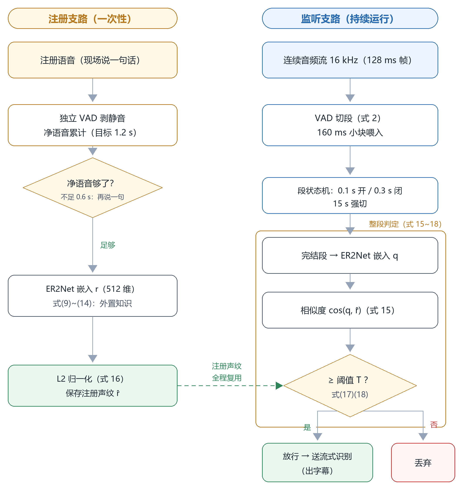
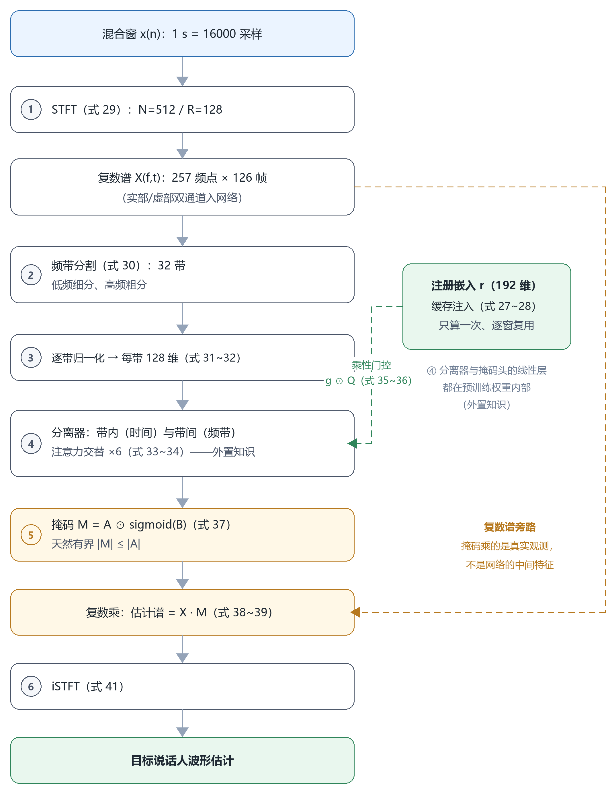
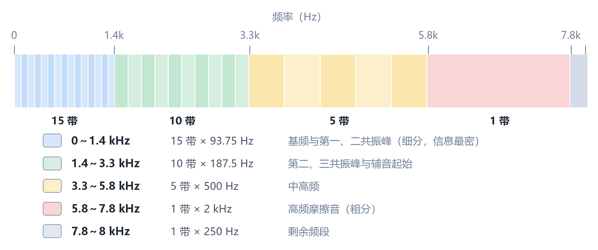
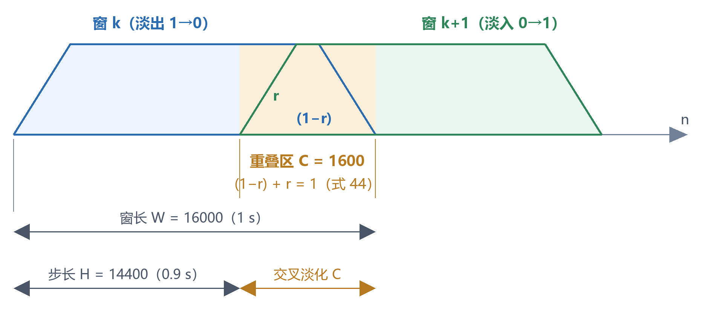
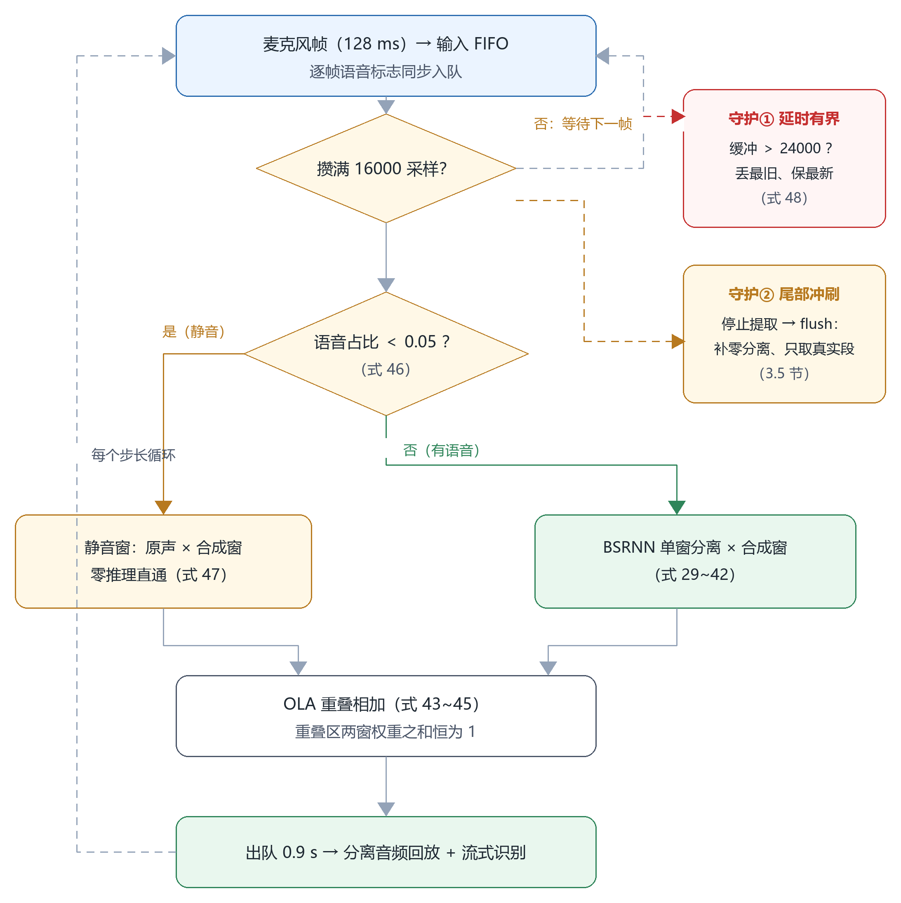

# 摘要

多人同时说话时，怎么只留下指定那个人的声音？本文围绕这个需求，把同一套实时语音系统里两种互补算法的数学形式从头到尾讲清楚。**算法一声纹门控**：用语音活动检测把连续音频切成一句句，对每句话提一个说话人嵌入向量，跟注册人的嵌入算余弦相似度，一句话一句话地取舍——像，就放行；不像，就丢掉。它算得极快（实时因子约 0.06），还配了短注册阈值补偿、流式滑窗判定与指数平滑一整套机制；但“按整句取舍”的天性决定了它对付不了两人同时说话的重叠语音。**算法二目标说话人提取（TSE）**：拿注册语音的嵌入当条件，让因果频带分割循环网络（BSRNN）在复数频谱上估计一个复数比值掩码，直接把目标人的时域波形重构出来——重叠语音也能拆；再配上 1 秒分块推理、满足恒定重叠相加条件的合成窗、积压丢弃与静音旁路四项流式化机制，纯 CPU 就能做到端到端首字延时约 1.7～2.5 秒、实时因子约 0.8。文中每条公式都配了“符号什么意思、为什么这么设计、工程上带来什么后果”的解读，并标明它落在工程源码的哪个位置，分清“工程实现”“依赖库实现”与“预训练模型内部的**外置知识**”三种情形；最后用实测数据说明两种算法各自的质量—延迟—算力账与适用边界。

**关键词**：目标说话人提取；声纹门控；BSRNN；复数比值掩码；说话人嵌入；余弦相似度；重叠相加；实时因子

# 1 引言

## 1.1 问题背景

真实环境里，麦克风听到的从来不是一个人的声音，而是好几个声源叠在一起。先把房间反射这类次要因素放一边，混合过程可以简化成直接相加：

$$x(n) = s_1(n) + s_2(n) + v(n) \qquad (1)$$

**要点**：x(n) 是麦克风信号，s₁(n)、s₂(n) 是两个人的声音，v(n) 是环境噪声，n 是采样点编号。别觉得“两个人加噪声”这设定太简单——难点已经全在里面了（两个同类型声源相互纠缠），人再多无非是求和项多一点，结论不变。人耳能在这样的混合里自然地“只听某一个人”，自动系统做起来却非常难，这就是鸡尾酒会问题。对下游任务（语音识别、会议纪要、录音、助听器）来说，混合信号会明显拉低质量，所以“只取目标人”是刚需。

## 1.2 两种算法的定位

本文所述系统面向单麦克风、纯 CPU、实时的约束，在同一协议下实现两种算法，按场景互补取用：

| | 算法一：声纹门控 | 算法二：目标说话人提取 |
|---|---|---|
| 核心思想 | 不改波形，按“这句话像不像注册人”逐段取舍 | 改写波形，从混合频谱中重构目标人的声音 |
| 两人同时说话 | 不能（原理性边界，2.7 节） | 能（逐时频点决定保留多少，3.3 节） |
| 计算代价 | 极低（实时因子约 0.06） | 较高（实时因子约 0.8） |
| 首字延时 | 约 0.5 秒粒度 | 约 1.7～2.5 秒 |
| 适用场景 | 轮流发言：问答、指令、会议主持 | 抢话、打断、重叠发言 |

**公共约定**：全系统统一 16 kHz 采样、单声道；实时音频每 128 毫秒一帧往前走；说话人嵌入（2.4 节）可以理解成描述“这声音是谁”的定长向量。两种算法共用同一套注册流程——目标人先念一段注册语音，系统算出他的嵌入向量存起来，之后所有判定都拿它当参照。

## 1.3 关于公式与代码的关系（外置知识的说明）

本文每条公式都给数学形式，同时在第 2.8 节、第 3.6 节贴出工程源码的对应节选，附录 A 还有全量的“公式—代码对照表”。有一点要先说清楚：**不是每条公式都能在本工程源码里找到对应的实现代码**。按实现位置分三类：

1. **工程实现**——逻辑就写在本工程源码里，比如余弦相似度、阈值判定、指数平滑、合成窗、重叠相加、静音旁路；
2. **依赖库实现**——本工程只有一行调用，真正的计算细节在依赖库里（比如短时傅里叶变换在 PyTorch 里、Fbank 特征前端在 sherpa-onnx 的原生代码里）；
3. **外置知识**——计算发生在**预训练模型的权重内部**（比如说话人网络的注意力池化、分离网络的双路径注意力），本工程和依赖库的公开源码里都找不到这些公式的逐项实现，能看到的只有整个网络的一次前向调用。这类公式的数学形式来自模型的结构定义与上游文献，相当于“用预训练权重换来的知识”，本文按其结构照实描述。

三类情形在正文相应公式的要点中逐一标注，汇总见附录 A。

**主要符号**（局部符号在各自公式处说明）：

| 符号 | 含义 |
|---|---|
| x(n)、s(n)、ŝ(n)、y(n) | 混合信号、目标真实语音、分离估计（帽子表示估计值）、拼接输出 |
| L = 400、S = 160 | 声纹特征的帧长（25 毫秒）与帧移（10 毫秒） |
| N = 512、R = 128 | 分离网络频域变换的窗长（32 毫秒）与帧移（8 毫秒） |
| W = 16000、C = 1600、H = 14400 | 分离窗口长（1 秒）、交叉淡化长（0.1 秒）、步长（0.9 秒） |
| X(f, t)、Ŝ(f, t) | 复数频谱及其估计；Re、Im 取实部、虚部 |
| F(m, t) | 80 维梅尔滤波器组特征 |
| e | 说话人嵌入；r 表示注册嵌入、q 表示待判段嵌入 |
| T、T′ | 整句判定阈值（0.5）、短注册补偿阈值（0.35） |
| λ | 指数平滑系数（0.5） |
| ρ | 占比（重叠段中目标人占比、窗口内语音占比） |
| (a, b)、\|a\| | 圆括号内两个向量做**内积**（对应元素相乘后求和，即点积）；\|a\| 为向量模长 |
| ⊙ | 逐元素相乘 |

# 2 算法一：声纹门控

## 2.1 总体流程

声纹门控压根不想“分离”声音，它只回答一个问题：**刚说完的这句话，是不是注册的那个人说的**。是，就把这段音频送去后续识别；不是，直接丢掉。

流程分两条支路。**注册支路**：注册语音先过一遍独立的语音活动检测剥掉静音，净语音拼起来后提一个说话人嵌入 r，长度归一化后存成 r̂。**监听支路**：连续音频流由语音活动检测切成一句句完结的段，每段提一个嵌入 q，跟 r̂ 算余弦相似度，过了阈值就放行。两条支路各用一套独立的检测器实例——这个模型内部有记忆状态（2.2 节），两支路共用会把彼此的切段状态搅乱。



**流程说明**：图 1 左边是注册支路，一次性的事——净语音攒够目标时长（1.2 秒，约四到六个汉字）就自动结束，产出归一化的注册嵌入 r̂；右边是监听支路，跟着音频流一直跑。两条支路只在“cos(q, r̂) 判定”这一处汇合：阈值按注册净语音的长短在 0.5 和 0.35 之间切换（式 18），还没注册时监听支路一律放行。流式场景（打字机字幕）下，监听支路的“整段判定”换成 2.6 节的滑窗判定：每 500 毫秒拿最近 1 秒判一次，指数平滑后跟独立阈值 0.25 比（式 20–22），过了就把这一块立刻送识别，不用攒整句。

## 2.2 语音活动检测与切段

用一个很轻的神经网络检测器（模型不到 2 MB），逐帧输出“这帧是语音”的概率：

$$p(t) = P(\mathrm{speech} \mid x,\ h) \qquad (2)$$

判定规则很简单：p(t) ≥ 0.5 就认为第 t 帧是语音。

**要点**：公式右边的条件有两部分——x 是当前帧的波形，h 是模型内部的循环状态（对前面所有帧的记忆）。这是个**序列模型**，不是逐帧独立分类：有记忆，噪声环境下的判定就更稳，因为模型“知道”前面的声音听起来像什么。**概率计算本身是外置知识**——发生在检测模型的权重内部，工程代码只干两件事：按 160 毫秒小块把音频喂进去、把判定结果取出来。由此带来两条工程约束：一是状态不能跨会话复用，上一个人的尾音会漏进下一个人的判定；二是输入必须切成 160 毫秒小块喂，实测几秒音频一次性喂进去会丢段边界。帧级判定之上是三参数的段状态机：连续语音满 0.1 秒开段（滤掉咳嗽、碰撞这类瞬态）；开段后连续静音满 0.3 秒闭段（停顿够长才算“说完”）；单段满 15 秒强制闭合（防长句没有边界，段缓冲上限 30 秒兜底）。0.3 秒这个数直接决定门控的判定粒度和延迟——它就是“一句话”的定义。

## 2.3 声学特征：梅尔滤波器组与均值归一化

声纹模型的输入不是波形，而是 80 维对数梅尔滤波器组特征。计算分四步。**说明**：这四步（式 3–8）的特征前端在 sherpa-onnx 的原生代码（C/C++）里完成，属于**依赖库实现**——本工程源码只有一行 `compute_fbank` 调用，公式细节不在本工程代码里；参数（25 毫秒帧长、10 毫秒帧移、80 维）必须跟模型训练时严格一致。

**第一步，分帧加窗**。给每帧乘一个汉宁窗：

$$w(i) = 0.5\left(1 - \cos\frac{2\pi i}{L}\right) \qquad (3)$$

**要点**：L = 400 个采样就是 25 毫秒——刚好装得下 2～3 个基音周期（基频 80～300 Hz），窗内的共振峰结构基本不动；相邻帧往前挪 S = 160 个采样即 10 毫秒，保住时间分辨率。窗两端平滑压到零，免得硬截波形造成频谱泄漏。

**第二步，加窗傅里叶变换与功率谱**（分帧、加窗、变换合成一条式）：

$$X(f, t) = \sum_{i=0}^{L-1} x(tS + i)\; w(i)\; e^{-j2\pi f i / L} \qquad (4)$$

$$P(f, t) = \left|X(f, t)\right|^2 \qquad (5)$$

**要点**：式 (4) 里 x(tS + i) 的意思是“从第 tS 个采样起取出一帧”；指数项是旋转因子，j 是虚数单位。X(f, t) 是复数：模告诉你“第 t 帧频率 f 处有多强”，辐角是相位。式 (5) 取模平方，复数谱就变成了非负的功率谱——回答“这一帧每个频率上有多强”。到这一步只要强度，相位先放一边。

**第三步，梅尔刻度滤波器组**。梅尔刻度模仿人耳的频率轴——低频分得细、高频分得粗：

$$\mathrm{Mel}(f) = 2595 \cdot \log_{10}\left(1 + \frac{f}{700}\right) \qquad (6)$$

80 个三角滤波器按梅尔刻度排开，对功率谱加权求和，再取个对数：

$$F(m, t) = \ln\left(\sum_{f} H_m(f)\, P(f, t)\right), \qquad m = 1, 2, \ldots, 80 \qquad (7)$$

**要点**：H(f) 带下标 m 指第 m 个三角滤波器的加权曲线。为什么这么分组：基频和第一、二共振峰都在低频，是区分音素和说话人的主要信息区，滤波器排得密；高频只剩摩擦音细节，排疏一点。取对数有两个用处：一是把动态范围压到人耳响度感知的量级；二是**把信道的乘性增益变成加性偏置**——正好为下一步的归一化铺路。

**第四步，倒谱均值归一化（CMN）**。逐通道减掉该段时间均值：

$$F'(m, t) = F(m, t) - \bar{F}(m) \qquad (8)$$

**要点**：F 头上一横杠表示第 m 维在整个输入段上的平均。作用可以一步步推出来：设麦克风/信道的频率响应是乘性增益 G，测到的功率谱就是 G·P，取对数后变成 ln P + ln G；再减去时间均值，跟时间无关的 ln G 项就被整个消掉了。**同一个人换台设备录，特征因此更稳定**，嵌入不那么受录音条件影响。

## 2.4 说话人嵌入：帧级编码与注意力统计池化

门控用 ER2Net 网络（中文数据训练，输出 512 维）；第 3 章分离算法用的 ECAPA-TDNN（输出 192 维）是同一家族。两者都是“帧级编码 → 统计池化 → 投影”三段式。**说明**：式 (9)–(14) 的全部计算都发生在预训练模型的权重内部（**外置知识**）——工程代码只有一次 `embed()` 前向调用（见 2.8 节代码 2-2），下面的公式按模型结构定义来描述。

**帧级编码**：把每帧 80 维特征变成一个带局部上下文的高维向量

$$h(t) = \mathrm{Encoder}\big(F'(t-\delta),\ \ldots,\ F'(t),\ \ldots,\ F'(t+\delta)\big) \qquad (9)$$

**要点**：编码器由多层卷积加残差连接组成，δ 是感受野半径——也就是每个 h(t) 都“看过”前后若干帧。这一步把单帧信息（一个音素的频谱切片）变成带上下文的信息（这个音素在语流里的样子）。说话人信息恰恰大量藏在动态里：同一个音素，不同人的咬字方式不一样。

一段语音有几十到几百帧，得压缩成一个定长向量，又不能把“谁在说”这个信息平均掉。方案是**注意力统计池化**。先给每帧打一个“说话人信息量”分数：

$$a(t) = \big(u,\ \tanh(A\, h(t) + c)\big) \qquad (10)$$

$$\alpha(t) = \frac{e^{\,a(t)}}{\sum_{t'} e^{\,a(t')}} \qquad (11)$$

$$\mu = \sum_{t} \alpha(t)\, h(t) \qquad (12)$$

$$\sigma = \sqrt{\sum_{t} \alpha(t)\, \big(h(t) - \mu\big)^2} \qquad (13)$$

$$e = D\,[\,\mu;\ \sigma\,] \in \mathbb{R}^{512} \qquad (14)$$

**要点**（逐条说；本文的圆括号表示内积，即括号里两个向量对应元素相乘再求和）：

- 式 (10)：u、A、c 都是训练学出来的参数；(u, tanh(A h(t) + c)) 就是向量 u 跟变换后的帧特征做内积，得到一个标量分数——“这一帧带了多少说话人信息”。tanh 有界，分数不会发散。
- 式 (11)：softmax 把任意分数归一成非负、加起来等于 1 的权重 α(t)。总和为 1 意味着后面的加权平均是**凸组合**——输出量级不跟着句长漂，短句长句的统计量可以比。
- 式 (12)：加权均值 μ 画的是“这个人的声音平均长什么样”——静态特征。
- 式 (13)：加权标准差 σ 画的是“抑扬变化的范围”——动态特征。对比一下：早期方法对所有帧一视同仁地平均（静音帧、噪声帧和有效帧同权），说话人信息被稀释；注意力让网络自己学会“元音稳态段权重要高、停顿权重要低”。
- 式 (14)：拼接后经可学习矩阵 D 投影到 512 维。训练目标（说话人分类）把嵌入空间整成了“同人扎堆、异人分开”的**方向分布**——这就是 2.5 节能直接用余弦判定、工程上一不用再训练的根本原因。

## 2.5 相似度计算与判定

两段声音是不是同一个人，最后归结为两个嵌入向量的夹角：

$$\cos(a, b) = \frac{(a,\, b)}{|a|\,|b|} \qquad (15)$$

注册嵌入存下来之前先做长度归一化：

$$\hat{r} = \frac{r}{|r| + \epsilon}, \qquad \epsilon = 10^{-8} \qquad (16)$$

判定规则：

$$\text{放行} \iff \cos(q,\ \hat{r}\,) \ge T, \qquad T = 0.5 \qquad (17)$$

**要点**：式 (15) 就是两向量夹角的余弦，取值 −1 到 1——分子 (a, b) 是内积，分母是两个模长的乘积；余弦只比**方向**，跟长度没关系。嵌入的长度受音量、时长、情绪影响很大，而“是谁”的信息藏在方向里，所以余弦是对口的度量（实测中文非同人对的余弦不超过 0.14，同人分得足够开）。式 (16) 归一化后 |r̂| = 1，ε 只是防零向量除零；此后每次判定就退化成“一次内积除以一个标量”，代价只跟维度 512 挂钩，跟音频时长无关。式 (17) 里 q 是待判段的嵌入。还有一条重要约定：**没注册时一律放行**——门控的意义是筛出已知目标，没有目标的时候不该把什么都拦下来。式 (15)–(17) 都是**工程实现**（见 2.8 节代码 2-2）。

## 2.6 阈值体系：短注册补偿与流式滑窗

固定阈值 0.5 不是在哪儿都合适，系统实际用的是一套按上下文分层的阈值。

**第一层：短注册补偿**。实测发现注册语音越短，目标人段落的相似度整体越低（注册嵌入“没平均够”、方向偏了），阈值不降的话会误拒“贴线”的目标段。注册净语音（检测剥完静音后）不足 1.5 秒时，阈值按系数 0.7 下调：

$$T' = 0.7\,T = 0.35 \qquad (18)$$

**要点**：0.7 不是拍脑袋拍的——四字级注册（约 1 秒净语音）下，目标段相似度实测下限约 0.48，陌生人都在 −0.17 以下；取 0.35 正好落在两者中间，两边都留了余量。实测数据：

| 注册净语音 | 生效阈值 | 目标段相似度 | 陌生人相似度 | 判定 |
|---|---|---|---|---|
| 3.72 秒 | 0.50 | 0.586～0.711 | −0.072 | 全对 |
| 2.24 秒 | 0.50 | 0.523～0.903 | −0.038 | 全对 |
| 1.03 秒（四字级） | 0.35 | 0.480～0.791 | −0.166 | 全对 |
| 0.64 秒 | 0.35 | 0.383～0.683 | −0.216 | 全对（余量仅 0.03） |

规律很清楚：注册越短，目标段相似度整体往下走；陌生人始终贴着 0。结论：净语音 1 秒以上可用，0.6 秒是悬崖——系统据此把流式注册的净语音目标定在 1.2 秒（约四到六个汉字，说够自动完成），下限 0.6 秒，不够就提示再说一句。

**第二层：流式滑窗独立阈值**。字幕要边说边出字，不能等整句说完再判。做法是每攒 500 毫秒新音频，取**最近 1000 毫秒**滑窗判一次，过了立刻放行这个块。短窗嵌入方差大，相似度整体比整句低一截（实测：500 毫秒裸窗主讲人 0.20～0.57、中位 0.41；1000 毫秒滑窗 0.35～0.62、中位 0.52；陌生人不超过 0.09），整句阈值 0.5 直接搬过来会把本人约四分之三的窗口误拒——两种粒度的阈值不能混用，滑窗判定用独立阈值 0.25，正落在两类分布间隙的正中。

**第三层：指数平滑**。先说静音直判——能量太低的块不送推理，因为静音的“声纹”就是一堆乱数：

$$\mathrm{rms}(x) = \sqrt{\frac{1}{K}\sum_{n} x^2(n)} < 0.01 \implies \text{静音块：直接拒绝，且不更新任何状态} \qquad (19)$$

非静音块判定后，相似度经指数平滑再比较：

$$\mathrm{score}(t) = \lambda\, c(t) + (1 - \lambda)\,\mathrm{score}(t-1), \qquad \lambda = 0.5 \qquad (20)$$

$$\mathrm{score}(t) = \lambda \sum_{i=0}^{t-1} (1-\lambda)^{i}\, c(t-i) + (1-\lambda)^{t}\,\mathrm{score}(0) \qquad (21)$$

$$\text{放行} \iff \mathrm{score}(t) \ge 0.25 \qquad (22)$$

**要点**：式 (20) 里 c(t) 是第 t 窗的原始余弦相似度；式 (21) 是把递推式展开——平滑分就是历史判定值的指数加权平均，λ = 0.5 时各窗权重依次是 0.5、0.25、0.125……等效平均窗长约两个判定窗（1 秒）。作用相当于给判定序列加了个低通滤波：半句话里声纹的天然漂移被抹平，字幕不再闪烁；代价是大约一个判定窗的响应滞后，换人说话时一到两窗内翻过来。这是“字幕稳”和“切换快”之间明摆着的折中，λ 可调，设成零就是关掉平滑。静音块不进递推（式 19 已经拦下），免得乱数污染平滑状态；重新开口后的第一个块立刻补一次判定。式 (18)–(22) 都是**工程实现**（见 2.8 节代码 2-2、代码 2-3）。

## 2.7 原理性边界：重叠语音为何无解

假设一段里两人同时说话。池化统计量（式 12、13）是帧特征的加权和，把段内的帧按“目标人的帧 / 别人的帧”分个类，混合段的嵌入就近似成两个嵌入的加权平均：

$$q \approx \rho\, r + (1 - \rho)\, o \qquad (23)$$

**要点**：ρ 是目标人有效语音帧在这段里的占比，o 是另一个人的嵌入，q 是这段混合语音实际算出来的嵌入。由式 (23)，相似度 cos(q, r̂) 会随 ρ 从 0 到 1 **连续**变化：ρ → 1 时趋向 1（该放行），ρ → 0 时落到陌生人对的水平（该拒绝），中间必然扫过阈值。于是存在一个过渡点：ρ 大于它该放、小于它该拒，可相似度在过渡点附近是连续变化的，**任何单一阈值都不可能两边全对**——阈值放宽，对方的话也跟着转写进来（误收）；收紧，目标人的话被丢掉（漏收）。两头不可兼得。这不是实现没做好，而是“整段取舍”没有波形重构自由度的数学必然（本式为理论分析，无对应代码）。下一章的分离算法在每个时频点上独立决定保留多少（相当于 ρ 逐点可控），从原理上跨过了这道边界。

## 2.8 实现对照：算法一的代码节选

下面是工程源码节选，做成“截图式”代码图：**重点行用红框框出、编上号，图下方的注释面板给出对应的公式编号与作用说明**。代码里“式 (n)”字样的行内注释是本文加的，其余保持源码原样；机械性的代码用 … 省略。

**代码 2-1**：VAD 切段参数与 160 毫秒分块喂入（`sdk/web/src/full/vad.ts`，节选）——式 (2) 的概率计算在模型内部（外置知识），切段三参数与分块策略是工程实现：

```ts
export const DEFAULT_VAD_OPTIONS: SileroVadOptions = {
  threshold: 0.5,               // 式(2)：帧级语音概率阈值
  minSilenceDuration: 0.3,      // 闭段：停顿满 0.3 秒才算“说完”
  minSpeechDuration: 0.1,       // 开段：短于 0.1 秒的瞬态忽略
  maxSpeechDuration: 15.0,      // 强切：单段上限 15 秒
}
// 有状态模型对大块单次喂入会丢段边界：统一切成 160ms 小块喂入
const CHUNK = 2560              // 2560 采样 = 160ms @16kHz
acceptWaveform(samples: Float32Array): void {
  for (let offset = 0; offset < samples.length; offset += CHUNK) {
    inner.acceptWaveform(samples.subarray(offset, Math.min(offset + CHUNK, samples.length)))
  }
}
```

**代码 2-2**：声纹提取调用、余弦、归一化与阈值判定（`sdk/web/src/core/voice-filter.ts` 与 `embedder.ts`，节选）——注意 `embed()` 内只有一次原生前向调用，式 (9)–(14) 的细节都在模型内部：

```ts
// embedder.ts —— 式(3)~(14) 全部在预训练模型内部完成（外置知识 + 依赖库实现）
async embed(samples: Float32Array): Promise<Float32Array> {
  const stream = this.extractor.createStream()
  stream.acceptWaveform({ samples, sampleRate: 16000 })
  stream.inputFinished()
  const embedding = this.extractor.compute(stream, false)   // → 512 维嵌入
  if (!embedding || embedding.length === 0) throw new Error('audio too short for one frame')
  return embedding
}

// voice-filter.ts —— 式(15)~(18)：余弦、L2 归一化、短注册补偿均为工程实现
export function cosine(left: Float32Array, right: Float32Array): number {
  let dot = 0, ln = 0, rn = 0
  for (let i = 0; i < left.length; i++) {
    dot += left[i] * right[i]          // 式(15) 分子：内积 (a, b)
    ln += left[i] * left[i]
    rn += right[i] * right[i]
  }
  const denominator = Math.sqrt(ln) * Math.sqrt(rn)   // 式(15) 分母：|a|·|b|
  return denominator > 1e-8 ? dot / denominator : 0.0
}
const SHORT_ENROLL_BOUNDARY_SECONDS = 1.5   // 短注册边界
async enroll(samples: Float32Array): Promise<EnrollResult> {
  const embedding = await this.embedder.embed(samples)
  let norm = 0
  for (const v of embedding) norm += v * v
  norm = Math.sqrt(norm) + 1e-8                     // 式(16)：|r| + ε
  const normalized = new Float32Array(embedding.length)
  for (let i = 0; i < embedding.length; i++) normalized[i] = embedding[i] / norm
  this.enrollment = normalized                      // 保存归一化 r
  const speechSeconds = samples.length / SAMPLE_RATE
  this.activeThreshold =                            // 式(18)：短注册补偿
    speechSeconds < SHORT_ENROLL_BOUNDARY_SECONDS
      ? this.threshold * this.shortEnrollFactor     // 0.5 × 0.7 = 0.35
      : this.threshold
  return { speechSeconds }
}
async judge(samples: Float32Array): Promise<JudgeResult> {
  if (this.enrollment === null)
    return { similarity: 1.0, accepted: true, durationSeconds: … }   // 未注册恒放行
  const similarity = cosine(await this.embedder.embed(samples), this.enrollment)  // 式(17)
  return { similarity, accepted: similarity >= this.activeThreshold, … }
}
```

**代码 2-3**：流式滑窗与指数平滑（`sdk/web/src/core/stream-gate.ts`，节选）——式 (19)–(22)：

```ts
async push(chunk: Float32Array): Promise<StreamGateVerdict> {
  const silent = rms(chunk) < this.silenceRms          // 式(19)：RMS < 0.01
  …                                             // 滑窗缓冲追加（只保留最近 1000ms）
  this.pending += chunk.length
  if (silent)                                   // 静音：不推理、不动平滑状态
    return { accepted: false, similarity: null, score: this.score, silent: true }
  if (!this.filter.enrolled) { this.pending = 0; return … }   // 未注册放行
  if (this.pending < this.hopSamples) {         // 凑步中（<500ms）：沿用上次结论
    const accepted = this.score === null ? true : this.score >= this.threshold
    return …
  }
  this.pending = 0
  const { similarity } = await this.filter.judge(this.buf)   // 最近 1s 滑窗判定
  this.lastSimilarity = similarity
  this.score =
    this.smoothing > 0 && this.score !== null
      ? this.smoothing * similarity + (1 - this.smoothing) * this.score   // 式(20) EMA
      : similarity
  return { accepted: this.score >= this.threshold, similarity, score: this.score, … }
}                                               // 式(22)：score ≥ 0.25
```

# 3 算法二：目标说话人提取（TSE）

## 3.1 任务定义与训练目标

已知混合信号和目标人的注册语音，要估出目标人的声音：

$$\hat{s}(n) = f_{\theta}(x,\ r) \qquad (24)$$

训练目标是尺度不变信噪比（SI-SDR）。先把估计往真实信号的方向上投影：

$$c = \frac{(\hat{s},\, s)}{|s|^2} \qquad (25)$$

$$\mathrm{SI\text{-}SDR} = 10\,\log_{10}\frac{|c\,s|^2}{|c\,s - \hat{s}|^2} \qquad (26)$$

**要点**：式 (24) 里 f 是分离网络，θ 是预训练参数，r 是注册嵌入——**“是谁”作为条件直接进了函数的输入**。跟盲源分离的本质区别就在这：盲分离不知道哪一路是目标、输出几路还得先给先验；这里网络只需要估这一路信号，结构上就绕开了“先分离、再认人”的两阶段误差。式 (25)：分子 (ŝ, s) 是内积，c 是让 |ŝ − cs| 最小的系数，也就是 ŝ 在目标方向上的正交投影系数；cs 是估计里跟目标同向的“信号分量”，ŝ − cs 是“误差分量”（干扰泄漏 + 噪声 + 畸变），式 (26) 取两者能量之比换算成分贝。尺度不变性：ŝ 整体放大多少倍，分子分母同倍放大，比值不动——**损失只管波形形状、不管整体增益**，这跟 3.3 节末尾“逐窗不做幅度归一化”正好配套。**外置说明**：式 (24)–(26) 是训练期的定义，发生在上游训练框架里；本工程只做推理，源码中没有对应实现。

## 3.2 注册嵌入的计算与缓存注入

分离算法用 ECAPA-TDNN（192 维）算注册条件，结构跟 2.4 节讲的一样：

$$r = \mathrm{ECAPA}\big(F'(\text{注册语音})\big) \in \mathbb{R}^{192} \qquad (27)$$

一个关键的工程决策：**嵌入只算一次，存起来，逐窗往里注入**。设一次提取共 K 个窗口，C₁ 是嵌入的单次计算成本、C₂ 是分离网络的单窗成本：

$$\text{逐窗重算：}\ K\,(C_1 + C_2) \qquad\quad \text{缓存注入：}\ C_1 + K\,C_2 \qquad (28)$$

**要点**：缓存省下 (K − 1)·C₁，提取越长省得越多；更要紧的是**条件一致性**——逐窗重算哪怕只差一丁点数值，相邻窗的掩码估计就多一个抖动源，拼接缝更脏。实测收益：换目标人只要重算嵌入约 0.06 秒，而重新加载约 262 MB 的网络权重要约 5 秒——“现场来了个陌生人，注册完马上能提”的响应瓶颈从权重加载挪到了算法本身必需的窗口累积。式 (27) 的网络前向是外置知识（在权重内部），特征调用和缓存注入是工程实现（见 3.6 节代码 3-1）。

## 3.3 单窗分离前向：从波形到波形

分离按 1 秒一个窗口逐窗进行（这是流式化的基础，见 3.4 节）。每窗六步，整体流程见图 2。



**流程说明**：图 2 从上到下是数据的六步变换：波形 → 复数谱 → 32 个频带 → 128 维带特征 → 分离器 → 掩码相乘 → 回到波形。有两条旁路，看懂它们就看懂了这张图——第一，原始复数谱 X 在第①步之后被旁路保留，绕开分离网络直接送到第⑤步做复数乘法（掩码乘的是“真实观测”，不是网络的中间特征）；第二，注册嵌入 r 从缓存直接注入分离器（第④步，虚线箭头），这正是式 (28) 的工程含义：条件只算一次、逐窗复用。第④步分离器内部的“带内时间注意力与带间频带注意力交替 ×6”是外置知识（式 33–36 在权重内部），流程图按它的结构画。

**第一步，频域变换**。语音在时频谱上比在波形上稀疏得多，不同说话人的能量在“频率 × 时间”格子上的分布不一样，“筛人”这件事在频域做要容易得多：

$$X(f, t) = \sum_{i=0}^{N-1} x(tR + i)\; w(i)\; e^{-j2\pi f i / N}, \qquad N = 512,\quad R = 128 \qquad (29)$$

**要点**：跟式 (4) 一样是加窗短时傅里叶变换，只是参数不同：这里窗长 32 毫秒、帧移 8 毫秒（分离网络训练时的配置），1 秒窗得到 257 个频点（每点 31.25 Hz，覆盖 0～8 kHz）× 126 帧的复数谱。复数谱拆成“实部、虚部两个通道”进网络（神经网络的张量是实数）；同时**原始复数谱另外旁路保留一份**，第五步复数乘法要用它。这一步是**依赖库实现**：工程代码调 PyTorch 的 `torch.stft`，变换本身在库里（代码 3-2 第 ① 步）。

**第二步，频带分割**。257 个频点不均匀地切成 32 个子带——低频切得细、高频切得粗：

| 带宽（频点数） | 带数 | 覆盖频率 | 依据 |
|---|---|---|---|
| 3（约 94 Hz） | 15 | 0～1.4 kHz | 基频与第一、二共振峰所在，信息密度最高 |
| 6（约 188 Hz） | 10 | 1.4～3.3 kHz | 第二、三共振峰与辅音起始 |
| 16（约 500 Hz） | 5 | 3.3～5.8 kHz | 中高频 |
| 64（约 2 kHz） | 1 | 5.8～7.8 kHz | 高频，只有摩擦音细节 |
| 8（约 250 Hz） | 1 | 7.8～8 kHz | 剩余频段 |

合计 15×3 + 10×6 + 5×16 + 1×64 + 1×8 = 257，与输入恰好对齐。每个频带拼成一个实数向量（局部符号）：

$$v = \big[\,\mathrm{Re}\,X;\ \ \mathrm{Im}\,X\,\big] \quad\text{（该带全部频点）} \qquad (30)$$

**要点**：分带有三条理由——带宽分配跟人耳临界频带先验对齐（低频细分、高频粗分）；全带 257 维向量太长，分带后每带是短向量，可以用独立的小网络建模；相邻频点高度相关，分带本身就是带先验的频率分组。式 (30) 的方括号意思是“该带各频点的实部排完再排虚部”，得到长度为“带宽 × 2”的向量（各带 6～128 维不等）。这一步是**工程实现**：切带循环和旁路保留都写在工程源码里（代码 3-2 第 ② 步），划分表来自训练配置文件。



**图 3 说明**：32 个频带的带宽沿频率轴不均匀排布——0～1.4 kHz 分给 15 个窄带（每带约 94 Hz，基频和第一、二共振峰都在这，说话人信息密度最高的区域切得最细），往上逐渐变宽，5.8～7.8 kHz 整整 2 kHz 只占一个带（高频只剩摩擦音细节，粗分就够了）。这种“低频密、高频疏”的结构跟人耳临界频带的感知先验一致，是 BSRNN 相对全带建模方法的关键结构选择。

**第三步，逐带归一化与线性编码**（m、d 是该带在训练集上统计的均值和方差，推理时固定不变；γ、β、U、b 是可学习参数，都是局部符号）：

$$z = \gamma\,\frac{v - m}{\sqrt{d^2 + \epsilon}} + \beta \qquad (31)$$

$$p = U\,z + b \in \mathbb{R}^{128} \qquad (32)$$

**要点**：低频带的能量比高频带高好几个数量级，不归一化的话，后续网络的有效输入范围就被低频带占了，高频带的细微模式被淹没。式 (31) 是逐带标准化再加可学习的缩放平移；式 (32) 把长短不一的各带统一到 128 维——从这往后各带在网络里可比、可交互。这一步是**外置知识（工程调用）**：归一化层和线性层的参数都在预训练权重里，工程代码只是逐带调一次（代码 3-2 第 ③ 步的 `bn_func`）。

**第四步，条件分离器——“是谁”在这一步起作用**。32 个带 × 126 帧的特征图沿两个方向交替做自注意力：

$$Q \leftarrow \mathrm{AttnTime}(Q) \qquad (33)$$

$$Q \leftarrow \mathrm{AttnBand}(Q) \qquad (34)$$

说话人条件通过乘性门控注进来：

$$g = \mathrm{sigmoid}(U\,r + b) \in \mathbb{R}^{128} \qquad (35)$$

$$Q \leftarrow g \odot Q \qquad (36)$$

**要点**：式 (33) 是每个频带内沿时间方向的注意力——建模这个带的时域包络和谐波结构（谁先开的口、基频轨迹怎么走）；式 (34) 是每个时刻沿频带方向的注意力——建模跨带的谐波与共振峰关联。两式交替堆 6 层（每层配前馈网络、残差和归一化）。这就是 BSRNN 的“双路径”结构：把二维网格上的注意力拆成行、列两个方向分别做，计算量从随格子数平方增长降到线性乘单方向长度，长程依赖却照样能跨全窗建立。式 (35) 把 192 维注册嵌入压成 128 维、再过 sigmoid 变成 0～1 的门控系数向量 g；式 (36) 拿 g 逐通道缩放特征，广播到全部频带和时刻——富含目标人共振峰模式的通道被放大，别人主导的通道被压下去。对比一下算法一：门控判的粒度是“一整段”（式 17），式 (35)(36) 把同一个先验撒到每个“频带 × 时刻”单元，等于在每个时频点上独立回答“这里保留多少目标人”。这一步是**外置知识**：分离器整体在预训练权重里，工程只把注册嵌入当参数传进一次 `model.separator(...)` 调用（代码 3-2 第 ④ 步）；具体投影位置和融合细节以权重结构为准，式 (35)(36) 描述的是它的乘性语义。

**第五步，复数比值掩码（CRM）**。每个频带接一个掩码头，输出两组实数图 A、B（局部符号），拼成掩码：

$$M = A \odot \mathrm{sigmoid}(B) \qquad (37)$$

掩码作为**比例**乘回**原始混合谱**（第一步旁路保留复数谱就是为了这一步）：

$$\hat{S} = X \cdot M \qquad (38)$$

实部虚部展开写就是：

$$\mathrm{Re}\,\hat{S} = \mathrm{Re}\,X \cdot \mathrm{Re}\,M - \mathrm{Im}\,X \cdot \mathrm{Im}\,M, \qquad \mathrm{Im}\,\hat{S} = \mathrm{Re}\,X \cdot \mathrm{Im}\,M + \mathrm{Im}\,X \cdot \mathrm{Re}\,M \qquad (39)$$

换极坐标看这一步：

$$\hat{S} = |X|\,|M|\; e^{\,j(\theta + \phi)} \qquad (40)$$

**要点**：式 (37) 的结构保证掩码**有界**——sigmoid 输出在 0 和 1 之间，所以逐点有 |M| ≤ |A|：训练稳定（梯度不会因为掩码爆炸）、推理不会冒出无限增益，这是相对“直接回归无界复数谱”的一个重要选择。式 (38)(39)：掩码不凭空造内容，输出始终锚在真实观测上——网络只要估“该留多少”（一个比值），比“生成一份频谱”好学得多；式 (39) 就是复数乘法的代数展开。式 (40) 里 θ、φ 分别是 X、M 的辐角：**幅度按 |M| 缩放、相位按 φ 旋转**。这是 CRM 比传统实数掩码强的地方——实数掩码只缩放不旋转，相位原样沿用混合信号；可两人重叠的时频点上，目标相位和混合相位并不一样，只缩放留下的相位失真就成了分离质量的硬上限。CRM 用“实部 + 虚部”两个自由度同时修幅度和相位，参数代价只是翻个倍。实现分两半：掩码头的线性变换在预训练权重里（外置），而 **A ⊙ sigmoid(B) 的组合和式 (38)(39) 的复数乘法是工程实现**，逐行写在工程源码里（代码 3-2 第 ⑤ 步）。式 (40) 是数学解释，无代码。

**第六步，逆变换回波形**。把估计谱逆变换回短时波形，再重叠相加：

$$\hat{s}(n) = \sum_{t} w(n - tR)\cdot \mathrm{IDFT}\big[\hat{S}(t, \cdot)\big]\big[\,n - tR\,\big] \qquad (41)$$

**要点**：IDFT 是逐帧逆傅里叶变换。式 (41) 和式 (29) 互为逆过程，同一个汉宁窗在重构中自补偿，保证“谱到波形”这一环本身不带失真。这一步是**依赖库实现**（`torch.istft`，代码 3-2 第 ⑥ 步）。另有一个关键约定：**逐窗输出不做幅度归一化**——要是每窗都各自归一化到固定峰值，相邻窗在拼接缝上的增益会跳，交叉淡化之后就成幅度调制噪声（能听见的“咔哒”）；而 SI-SDR 训练目标本来就不管增益（3.1 节），关掉归一化不伤模型假设，只在最后转整数采样时做限幅兜底。这个开关是工程实现（`set_output_norm(False)`）。

## 3.4 流式化：分块推理与重叠相加

离线模型一口气吃整段音频，实时麦克风流却要求不停地出结果。方案是 **1 秒分块逐窗推理**。本系统用的分离网络是因果（在线）变体——时间建模只依赖当前窗以内，不用任何未来帧，所以切窗独立推理不破坏模型假设，这是能流式化的前提。拼接的几何关系见图 4，运行期的主循环见图 5（3.5 节）。

新问题来了：每个 1 秒窗**独立**估计掩码，相邻两窗对边界处音频的估计对不齐，硬拼会让跨边界的字丢掉或畸变（听得见的断裂）。解法是重叠相加（OLA）加一个梯形合成窗。记窗长 W = 16000（1 秒）、交叉淡化长 C = 1600（0.1 秒）、步长 H = W − C = 14400（0.9 秒），合成窗定义如下：

$$\omega(n) = \frac{n}{C},\ 0 \le n < C; \qquad \omega(n) = 1,\ C \le n < W - C; \qquad \omega(n) = 1 - \frac{n - (W - C)}{C},\ W - C \le n < W \qquad (42)$$

每个窗的分离输出乘上 ω，再按步长累加：

$$y(n) = \sum_{k} \hat{s}^{(k)}(n - kH)\;\omega(n - kH) \qquad (43)$$

因为步长恰好是 H = W − C，任一采样点至多被相邻两窗盖住，窗权加起来恒等于 1：

$$\text{稳态区（单窗覆盖）：} \omega = 1; \qquad \text{重叠区：}\ (1 - r) + r = 1 \qquad (44)$$

重叠区里实际发生的事，是两份独立估计的交叉淡化：

$$y(n) = (1 - r)\,\hat{s}^{(k)}(n) + r\,\hat{s}^{(k+1)}(n) \qquad (45)$$

**要点**（这一组公式的核心）：

- 式 (42)：合成窗分三段——窗头 0→1 线性淡入、中段 0.9 秒恒 1、窗尾 1→0 线性淡出。头尾斜坡互补：一窗的淡出正好对上下一窗的淡入。
- 式 (43)：s 上标 (k) 表示第 k 窗的分离估计；每个估计乘完窗按 kH 的位置对齐累加。**注意别把两种窗搞混**：式 (29) 的汉宁窗是频域变换的分析窗（512 点、帧级）；式 (42) 的梯形窗是流式拼接的合成窗（16000 点、窗级），起作用的层级不一样。
- 式 (44)：r 是重叠区内的相对位置（0～1）。前一窗在这点的权重是 1 − r，后一窗是 r，加起来恒等于 1——这就是恒定重叠相加（COLA）条件：**拼接过程单位增益、不产生谱畸变**。两窗估计完全相同时，输出精确等于该估计；略有差异时（真实情况），差异被凸组合抹平。
- 式 (45)：接缝处的显式写法——两份独立估计的加权平均，权重加起来是 1，“无缝”两个字在数学上就是这个意思。
- **算力账**：重叠只占 C/W = 10%，相对算力开销约 W/H ≈ 1.11；要是按常见做法取 50% 重叠就是 2.0——本方案几乎不花钱就换来无缝。
- 实现层面：合成窗构造和重叠相加都是**工程实现**（代码 3-3），逐行可查。



**图 4 说明**：两个梯形分别是第 k 窗和第 k+1 窗的合成窗包络（式 42 的三段定义：0→1 淡入、中段恒 1、1→0 淡出）。窗 k 的淡出段和窗 k+1 的淡入段在重叠区 C 内对齐：任一采样点上两个窗权之和恒为 1（式 44），所以拼接是单位增益的。窗 k 和窗 k+1 是两次独立推理，对重叠区里同一段音频的估计略有差异——重叠区的实际输出是两份估计按 (1−r) 和 r 的凸组合（式 45），差异被平滑过渡掉，而不是硬切换。

窗口取多长，本身就是质量—延时的实测权衡：

| 窗口 | 分离质量（SI-SDR） | 首字延时 | 说明 |
|---|---|---|---|
| 2 秒 | 12.6 dB | 约 3.4 秒 | 整窗基线 |
| 1 秒（本系统） | 7.3 dB | 约 1.7 秒 | 以约 5 dB 换延时减半，算力不变 |
| 低于 0.75 秒 | 急剧下降 | — | 因果上下文不足，掩码估计崩坏 |

因果模型没有未来帧，窗口越短，能用来区分“同一时刻谁在说”的时间上下文就越少——两人频谱上是交叠的，靠的是**时间上的上下文差异**（谁先开的口、基频轨迹怎么延续）。1 秒就是这个预训练权重下质量—延时的实测拐点。

## 3.5 实时保障：静音旁路、积压丢弃与延迟预算



**流程说明**：图 5 是运行期的主循环，每 128 毫秒一帧驱动一轮：帧入队之后，只要输入缓冲攒满 16000 个采样（1 秒）就处理一个窗口；窗口先按语音占比分类——静音窗（占比 < 0.05）原声乘上合成窗直接放行，零推理（式 47）；有语音的窗注入缓存嵌入做分离（式 29–41）。两条路汇合进重叠相加缓冲，每个步长出队 0.9 秒送回放和识别（式 43）。两个守护机制挂在循环外旁：缓冲超限（窗口 + 0.5 秒容忍量）就丢最旧保最新，把延迟钳在有界（式 48）；停止提取时，尾部残窗补零分离一次、只取真实音频那段，保证末尾的字不丢、也不掺伪影。

**静音窗零推理旁路**。逐帧的语音标志跟输入缓冲逐采样对齐，每窗算一个语音占比：

$$\rho = \frac{1}{W} \sum_{n=0}^{W-1} \mathbf{1}[\,n\ \text{为语音}\,] \qquad (46)$$

$$\rho < 0.05 \implies \text{静音窗：直接放行}\ x(n)\,\omega(n)\text{，完全跳过分离前向} \qquad (47)$$

**要点**：1[·] 是指示函数（条件成立取 1，否则取 0），ρ 就是窗内“有语音”采样占的比例。静音直通**照样乘合成窗、照样走重叠相加**——静音和语音的接缝一样平滑，这是“跳过推理”但“不跳出拼接体系”的细节；实时对话里静音占比很高，平均算力大幅下降（旁路的窗口数计入运行指标）。语音标志拿不到时按全有语音处理（安全默认：宁可多算，不能漏话）。工程实现（代码 3-4）。

**积压丢弃，保证延时有界**。麦克风流不会暂停等你；CPU 一时跟不上，输入缓冲就无限涨、延迟越拖越大。规则：缓冲超过一个窗口加 0.5 秒容忍量（24000 个采样）时，丢掉最旧的溢出部分、只分离最新窗口，丢弃量累计上报。这样端到端延迟就有了与运行时长无关的上界：

$$D \le 0.128 + 1.5 + 0.76 \approx 2.4\ \text{（秒）} \qquad (48)$$

**要点**：三段构成——0.128 秒是帧打包；1.5 秒是缓冲驻留上限（窗口 1 秒 + 容忍 0.5 秒，丢弃动作把缓冲硬性钳在这个常数上）；0.76 秒是单窗前向耗时。正常负载下这个机制是空操作，只给异常负载（别的进程抢 CPU、推理抖动）兜底；被跳过的音频不参与转写——**宁可少转一句，不能让延迟无限涨**，而且丢弃量显式可观测，是明确的策略选择，不是悄悄丢数据。工程实现（代码 3-4）。

**停止时的尾部冲刷**。停止提取时残窗不够 1 秒：尾巴不短于 0.6 秒就补零到整窗分离一次，而且只输出真实音频占的那段（后面是补零伪影，不取）；短于 0.6 秒就只发已暂存的重叠尾部。末尾的字既不丢、也不被静音伪影弄脏。工程实现。

**两项指标的定义**。实时因子（处理耗时除以音频时长，小于 1 才跟得上实时）：

$$\mathrm{RTF} = \frac{t_1 + t_2}{0.9} \approx 0.8 \qquad (49)$$

首字延时的加性模型：

$$L \approx 0.06 + 1.0 + 0.76 + (0 \sim 0.66) \approx 1.9 \sim 2.5\ \text{（秒）} \qquad (50)$$

**要点**：式 (49) 里 t₁、t₂ 是单窗分离和识别的耗时，分母 0.9 秒是一个步长——每 0.9 秒做一次前向，但这次前向处理的是 1 秒音频，拿步长当分母才是“每秒音频要花多少秒 CPU”的真实口径。式 (50) 四项：注册嵌入 0.06 秒（缓存之后）；攒满窗口 1.0 秒（**因果模型的固有下限**，预加载消不掉，只能靠缩短窗口、搭上质量）；首窗前向 0.76 秒（冷启约 0.93 秒，预热后差距抹平）；识别尾部 0～0.66 秒（带右窗上下文的识别模型要补约 0.66 秒静音把末字“冲”出来，基于端点检测的模型可以趋近于零）。系统把权重加载（约 5 秒）和首次推理预热挪到连接后的空闲时段，到“点开始”那一刻只剩式 (50) 的固有部分。式 (49) 是工程实现（代码 3-5），式 (50) 是实测加性模型。

## 3.6 实现对照：算法二的代码节选

呈现方式同 2.8 节：重点行红框标注，图下方给对应注释。

**代码 3-1**：注册嵌入只算一次、逐窗注入（`app/backend/audio_tse/tse.py`，节选）——式 (27)(28)：

```python
# 注册支路：提取并缓存 ECAPA 嵌入（每次提取算一次）
self._cached_spk_embedding = engine.compute_enroll_embedding(enrollment_pcm16)

def compute_enroll_embedding(self, enrollment_pcm16):     # 式(27)
    enroll = self._to_tensor(enrollment_pcm16)
    feats = self._extractor.compute_fbank(enroll, sample_rate=SAMPLE_RATE, cmn=True)
    # ↑ Fbank+CMN 在原生库内完成（式 3~8，依赖库实现）
    tmp = self.model.spk_model(feats)          # ECAPA 前向：式(9)~(14) 在权重内部（外置）
    emb = tmp[-1] if isinstance(tmp, tuple) else tmp
    spk_embedding = self.model.spk_transform(emb)
    spk_embedding = spk_embedding.unsqueeze(1).unsqueeze(3)   # 广播形状，缓存
    return spk_embedding

# 热路径：每个窗口直接注入缓存的嵌入（式 28 右侧：C1 + K·C2）
seg = self._engine.extract_float(window, self._cached_spk_embedding) * self._synth_win
```

**代码 3-2**：单窗前向六步（`tse.py` 的 `_forward_cached`，节选）——式 (29)–(41)：

```python
# ① 频域变换（式 29）：工程调用，变换在 PyTorch 库内
spec = torch.stft(wav_input, n_fft=win, hop_length=stride,
                  window=window, return_complex=True)
spec_RI = torch.stack([spec.real, spec.imag], 1)     # 实/虚并成两个通道
# ② 频带分割（式 30）：工程实现——逐带切片，复数谱旁路保留
band_idx = 0
for i in range(len(model.band_width)):
    bw = model.band_width[i]
    subband_spec.append(spec_RI[:, :, band_idx:band_idx + bw].contiguous())
    subband_mix_spec.append(spec[:, band_idx:band_idx + bw])   # 复数旁路（第⑤步用）
    band_idx += bw
# ③ 逐带归一化（式 31~32）：工程调用，参数在预训练权重内（外置）
for i, bn_func in enumerate(model.BN):
    subband_feature.append(bn_func(subband_spec[i].view(...)))
# ④ 分离器（式 33~36）：外置——双路径注意力与说话人注入都在权重内部，
#    工程只把缓存的注册嵌入作为条件传入
sep_output = model.separator(subband_feature, spk_embedding, torch.tensor(nch))
# ⑤ 复数比值掩码（式 37~39）：组合与复数乘法是工程实现
for i, mask_func in enumerate(model.mask):            # mask_func：掩码头线性层（外置）
    this_output = mask_func(sep_output[:, i]).view(batch_size, 2, 2, bw, -1)
    this_mask = this_output[:, 0] * torch.sigmoid(this_output[:, 1])   # 式(37) M = A⊙sigmoid(B)
    est_real = (subband_mix_spec[i].real * this_mask[:, 0]
                - subband_mix_spec[i].imag * this_mask[:, 1])          # 式(39) Re Ŝ
    est_imag = (subband_mix_spec[i].real * this_mask[:, 1]
                + subband_mix_spec[i].imag * this_mask[:, 0])          # 式(39) Im Ŝ
    sep_subband_spec.append(torch.complex(est_real, est_imag))
est_spec = torch.cat(sep_subband_spec, 1)
# ⑥ 逆变换（式 41）：工程调用（torch.istft 即加权重叠相加）
output = torch.istft(est_spec.view(batch_size, model.enc_dim, -1),
                     n_fft=win, hop_length=stride, window=window, length=nsample)
# 逐窗不做幅度归一化（3.1 节尺度不变性的工程配套）：
self._extractor.set_output_norm(False)
```

**代码 3-3**：合成窗与重叠相加（`tse.py`，节选）——式 (42)–(45)：

```python
# 梯形合成窗（式 42）：头尾线性 ramp，互补保证重叠区之和恒为 1
ramp = np.linspace(0.0, 1.0, self._cf_samples, endpoint=False)   # C=1600，半开区间
win = np.ones(self._window_samples, dtype=np.float32)
win[: self._cf_samples] = ramp              # 窗头 0→1（淡入）
win[-self._cf_samples:] = 1.0 - ramp        # 窗尾 1→0（淡出）
self._synth_win = win

def _ola_add(self, seg):                    # 式(43) 的“加”半步
    n = len(seg)
    if len(self._out_overlap) < n:          # 首次调用补零扩展
        self._out_overlap = np.concatenate(
            [self._out_overlap, np.zeros(n - len(self._out_overlap), dtype=np.float32)])
    self._out_overlap[:n] += seg            # 重叠区自然叠加：前窗淡出 + 本窗淡入（式 45）

def _ola_take(self, hop):                   # 式(43) 的“取”半步
    ready = self._out_overlap[:hop].copy()  # 头部 hop 个采样不会再被后续窗影响，直接出队
    self._out_overlap = self._out_overlap[hop:]
    return ready
```

**代码 3-4**：静音旁路与积压丢弃（`tse.py` 主循环，节选）——式 (46)–(48)：

```python
VOICE_RATIO_THRESHOLD = 0.05                # 式(47)：静音占比阈值
BACKLOG_TOLERANCE_SECONDS = 0.5             # 式(48)：容忍量（缓冲上限 = 窗 + 0.5s = 24000）
while len(self._in_buf) >= self._window_samples:
    window = self._in_buf[: self._window_samples]
    voice_ratio = float(np.mean(self._buf_voice[: self._window_samples]))   # 式(46) ρ
    if voice_ratio < VOICE_RATIO_THRESHOLD:     # 静音窗：完全跳过 BSRNN 前向
        self.silent_windows += 1
        seg = window * self._synth_win          # 仍乘合成窗 → 仍走 OLA，接缝平滑
    else:
        seg = self._engine.extract_float(window, self._cached_spk_embedding) * self._synth_win
    self._ola_add(seg)
    outputs.append(self._to_pcm16(self._ola_take(self._hop_samples)))   # 出队 0.9s
    self._in_buf = self._in_buf[self._hop_samples:]       # 前进一个步长

def _shed_backlog(self):                    # 式(48)：超限丢最旧，只分离最新窗口
    if len(self._in_buf) <= self._max_buf_samples:
        return                              # 正常负载：空操作
    drop = len(self._in_buf) - self._window_samples
    self._in_buf = self._in_buf[drop:]
    self._buf_voice = self._buf_voice[drop:]        # 语音标志同步裁剪，保持对齐
    self.dropped_seconds += drop / SAMPLE_RATE      # 丢弃量累计上报（可观测）
```

**代码 3-5**：实时因子的分母口径（`app/backend/audio_tse/server.py`，节选）——式 (49)：

```python
# 一次 TSE 步长 == 窗长 − 交叉淡化（0.9s）；RTF 以此为分母（式 49）
HOP_MS = (WINDOW_SECONDS - CROSSFADE_SECONDS) * 1000.0
def rtf_for(processor, tse_ms, asr_ms):
    if processor == "tse":
        return (tse_ms + asr_ms) / HOP_MS if (tse_ms or asr_ms) else None
    return asr_ms / FRAME_MS if asr_ms else None    # 门控/直通：逐帧（128ms）处理
```

# 4 两种算法的对比与协同

两种算法可以用同一个数学视角串起来看。算法一把一整段音频的全部内容压进**一个**嵌入向量再做一次判定，等于对段内所有时频点取了平均权重 ρ（式 23）；算法二把同样的先验条件撒到**每个**时频点上分别决策（式 35、36），相当于 ρ 逐点可控。前者便宜，但重叠语音必然失真；后者贵一个数量级，但能重构波形。

| | 声纹门控 | 目标说话人提取 |
|---|---|---|
| 判定/作用粒度 | 段级（一句话） | 时频点级 |
| 输出 | 原始段音频（取舍） | 重构波形（改写） |
| 重叠语音 | 无解（式 23 的过渡带） | 可分离 |
| 实时因子 | 约 0.06 | 约 0.8（含识别） |
| 首字延时 | 约 0.5 秒粒度（滑窗） | 约 1.7～2.5 秒 |
| 模型体量 | 约 40 MB | 约 262 MB |
| 注册用量 | 1.2 秒净语音（四到六个汉字） | 3 秒以上 |

系统按“能门控就门控、要分离才分离”来取用：轮流发言的场景（问答、指令）用门控，延迟和算力都最优；有抢话、打断、重叠的场景用分离。两者共用同一套注册协议，前端可以无感切换。

# 5 实测性能

以下数据都是本系统在普通 CPU（无 GPU）上实测出来的：

| 指标 | 数值 | 条件 |
|---|---|---|
| 分离端到端首字延时 | 约 1.7 秒（固有口径）/ 1.9～2.5 秒（全口径） | 1 秒窗；2 秒窗约 3.4 秒 |
| 分离实时因子（含识别） | 约 0.8 | 与窗口基本无关 |
| 分离质量 SI-SDR | 12.6 dB（2 秒窗）→ 7.3 dB（1 秒窗） | 测试样本 |
| 换目标人响应 | 约 0.06 秒（仅重算嵌入）对 5 秒（重载权重） | 嵌入缓存 |
| 首窗前向耗时 | 冷启约 0.93 秒，预热后约 0.76 秒 | 预热为静音空转一次 |
| 门控实时因子 | 约 0.06（检测 + 声纹端到端） | 含切段 |
| 单次声纹推理 | 2 秒语音约 250 毫秒 | 38 MB 模型 |
| 中文说话人区分度 | 非同人对余弦不超过 0.14 | 测试对 |
| 四字级短注册 | 1.03 秒注册全对；0.64 秒在悬崖边 | 2.6 节表 |
| 流式滑窗两类分布 | 主讲人 0.35～0.62 对陌生人不超过 0.09，无重叠 | 1 秒滑窗 |

**局限与边界**（照实说）：当前分离权重是英语数据训练的，中文重叠语音上的泛化还有待实测验证；长时间运行的算力稳定性、窗口边界的听感，也还需要系统性评估；1 秒是当前权重的窗口下限，想要更短延时就得换或重训更轻量的因果模型。

# 6 结语

本文把实时说话人选择系统里两种算法的数学形式和实现对照完整讲了一遍。声纹门控走“检测切段—嵌入—余弦—阈值”这条路，用极低的代价完成段级筛选；它的分层阈值机制（整句阈值、短注册补偿、滑窗独立阈值、指数平滑）都经过实测分布校准，撑得起四字级短注册和打字机式流式判定；它的原理性边界（重叠语音的相似度过渡带）由嵌入的凸组合性质从数学上划清。目标说话人提取以注册嵌入为条件、以复数比值掩码为输出形式重构波形，配上分块推理、恒定重叠相加合成窗、积压丢弃、静音旁路这四项免训练的流式化机制，在纯 CPU 上跑到了实时。两者一个在段粒度上“选”、一个在时频点粒度上“滤”，合起来就是单麦克风实时场景下“只保留指定说话人”的一套完整方案。

# 附录 A：公式—代码对照表

三类属性的含义见 1.3 节：**工程实现** = 逻辑写在本工程源码里；**依赖库实现** = 工程一行调用、细节在依赖库；**外置知识** = 计算在预训练权重内部，源码（含依赖库公开代码）里没有逐项实现，公式按模型结构与上游文献描述。

| 公式 | 内容 | 实现位置 | 属性 |
|---|---|---|---|
| (1) | 信号模型 | — | 理论模型 |
| (2) | VAD 帧概率 | silero 模型权重内部 | 外置知识（切段参数、160ms 分块为工程实现：代码 2-1） |
| (3)–(8) | Fbank 特征与 CMN | sherpa-onnx 原生前端 | 依赖库实现（工程仅 `compute_fbank` 调用） |
| (9)–(14) | 帧级编码与注意力池化 | ER2Net / ECAPA 权重内部 | 外置知识（工程仅 `embed()` / `spk_model()` 调用：代码 2-2、3-1） |
| (15)–(17) | 余弦、归一化、判定 | `sdk/web/src/core/voice-filter.ts` | 工程实现：代码 2-2 |
| (18) | 短注册补偿 | `voice-filter.ts` | 工程实现：代码 2-2 |
| (19)–(22) | RMS、EMA、滑窗判定 | `sdk/web/src/core/stream-gate.ts` | 工程实现：代码 2-3 |
| (23) | 重叠段嵌入近似 | — | 理论分析 |
| (24)–(26) | 任务定义与 SI-SDR | 上游训练框架（训练期） | 外置知识（本工程只推理） |
| (27) | ECAPA 注册嵌入 | `tse.py` 调用权重前向 | 工程调用（网络内部外置：代码 3-1） |
| (28) | 嵌入缓存注入 | `tse.py` | 工程实现：代码 3-1 |
| (29) | STFT | `tse.py` 调 `torch.stft` | 依赖库实现：代码 3-2 ① |
| (30) | 频带分割 | `tse.py` 切带循环 | 工程实现：代码 3-2 ② |
| (31)–(32) | 逐带归一化与线性编码 | 预训练层 | 外置知识（工程仅 `bn_func` 调用：代码 3-2 ③） |
| (33)–(36) | 双路径注意力与说话人注入 | BSRNN 分离器权重内部 | 外置知识（工程传入嵌入：代码 3-2 ④） |
| (37)–(39) | CRM 组合与复数乘法 | `tse.py` 掩码后处理 | 工程实现（掩码头线性层外置：代码 3-2 ⑤） |
| (40) | 极坐标分解 | — | 数学解释 |
| (41) | iSTFT | `tse.py` 调 `torch.istft` | 依赖库实现：代码 3-2 ⑥ |
| (42)–(45) | 合成窗、OLA、COLA | `tse.py` | 工程实现：代码 3-3 |
| (46)–(47) | 静音旁路 | `tse.py` | 工程实现：代码 3-4 |
| (48) | 积压丢弃与延迟上界 | `tse.py` `_shed_backlog` | 工程实现：代码 3-4 |
| (49) | RTF 口径 | `server.py` `rtf_for` | 工程实现：代码 3-5 |
| (50) | 首字延时加性模型 | 实测归纳 | 实测模型 |

# 参考文献

1. 韩纪庆, 张磊, 郑铁然. 语音信号处理（第 2 版）. 北京：清华大学出版社, 2013.（中文教材：特征提取、说话人识别基础）
2. 赵力. 语音信号处理. 北京：机械工业出版社, 2003.（中文教材：声道模型与声学特征）
3. Goodfellow I, Bengio Y, Courville A. 深度学习. 赵申剑, 黎彧君, 符天凡, 等译. 北京：人民邮电出版社, 2017.（中文译本：神经网络与注意力机制基础）
4. 奥本海姆 A V, 威尔斯基 A S, 纳瓦布 S H. 信号与系统（第 2 版）. 刘树棠, 译. 西安：西安交通大学出版社, 1998.（中文译本：傅里叶变换与采样定理）
5. Luo Y., Yu J. Band-Split RNN: The Beat Goes On. *IEEE/ACM Transactions on Audio, Speech, and Language Processing*, 2023.（BSRNN 及其因果变体）
6. Williamson D. S., Wang D. L., Wang S. Complex Ratio Masking for Monaural Speech Separation. *IEEE Signal Processing Letters*, 2016.（复数比值掩码出处）
7. Desplanques C., Thienpondt J., Demuynck K. ECAPA-TDNN: Emphasized Channel Attention, Propagation and Aggregation in TDNN Based Speaker Verification. *Interspeech*, 2020.（注意力统计池化）
8. Wang Q., Muckenheim H., et al. VoiceFilter: Targeted Voice Separation by Speaker-Conditioned Spectrogram Masking. *Interspeech*, 2019.
9. Delcroix M., Zmolikova K., et al. Single-Channel Target Speaker Extraction and Recognition with Speaker Beam. *ICASSP*, 2018.
10. Ge M., Wang S., et al. SpEx: Multi-Task Time-Domain Speaker Extraction Network. *Interspeech*, 2020.
11. Luo Y., Mesgarani N. Conv-TasNet: Ideal Time-Domain Filters for Single-Channel Speech Separation. *IEEE/ACM TASLP*, 2019.
12. An F., Zhang H., et al. 3D-Speaker-Net: Reinforcing Speaker Embedding via Speaker Interaction and 3D Convolution. 2023.（ER2Net 声纹网络）
13. Silero Team. Silero VAD: Pre-Trained Enterprise-Grade Voice Activity Detector. 开源软件.
14. wenet-e2e 团队. WeSep / WeSpeaker: Open Source Speaker Extraction and Verification Toolkit.（本系统分离权重来源）
15. Yao Z., et al. Zipformer: Faster Than Transformer, Better in Unbounded 32k Vocabulary ASR. 2023；Geng M., et al. Paraformer: Fast and Accurate Parallel Speech Recognition. 2022.
